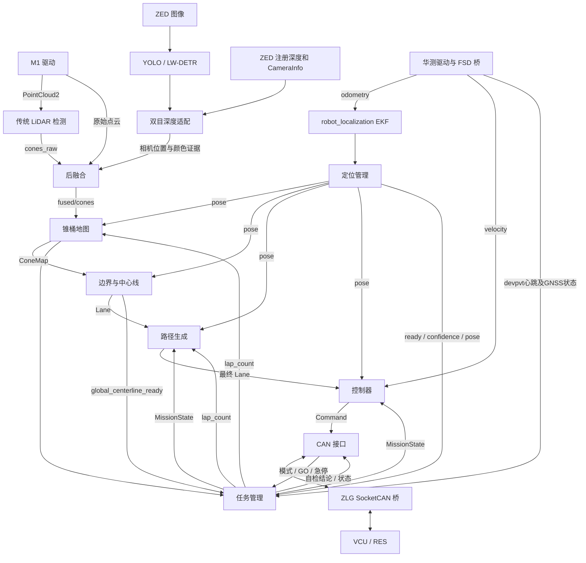

# 当前系统架构


> 核对：2026-10-13；入口依据 [start_full_fsd.sh](../start_full_fsd.sh)。本页是模块文件、功能、复用入口及职责归属的主说明，开始项目任务前先阅读。具体参数以模块配置和实际启动覆盖为准，不在这里维护调参值。按功能快速定位见 [代码索引](CODE_MAP.md)，消息契约见 [接口文档](ROS_INTERFACE.md)。

本文记录当前实现与部署范围；职责迁移方案不能当作已完成事实。发现文档与源码不一致时，先沿实际入口核对，再同步修正文档，不为符合旧文档另建实现。

## 1. 仓库边界

项目为 Formula Student Driverless 的 ROS 2 Humble 系统，提供实车感知、定位、建图、规划、控制、任务管理与 CAN 通信，以及隔离的仿真验证入口。

| 目录 | 职责及边界 |
| --- | --- |
| `WUTA-FSD/ros2_ws/src` | FSD 算法、消息、CAN 与第三方定位源码；Git 子模块 |
| `humble-chcnav-cgi_ros2pkg` | 华测通信解析、自定义消息及 FSD 坐标/速度桥；Git 子模块 |
| `zlgcan_bridge` | ZLG USB CAN 与虚拟 SocketCAN 双向桥、报文日志；Git 子模块 |
| `fsd-visualization-code` | 独立私有Git子模块：RViz、只读显示桥、诊断面板、安全图像插件和可选E22/Foxglove |
| `fsd_startup` | 独立 [WUTA-FSD-CLI](https://github.com/starry1N/WUTA-FSD-CLI) Git 子模块；启动管理界面、预检查、所属进程清理与日志生命周期；全栈部署委托根脚本 |
| `tools` | 配置审计、任务监控、启动监管、仿真适配、评估与回归 |
| `config` / `models` | 车辆与传感器外参、显示配置、机器相关推理引擎 |
| `docs` | 开发文档、专题记录与历史验证证据 |
| `.runtime` / `wuta_logs` / `log` | 运行状态、当前运行日志与构建产物；历史 `logs/` 仅作证据，不能当作源码入口 |

外部依赖包含 ZED/RoboSense 已安装 overlay、GPU 推理依赖和 WUTA-SIM 已安装环境。复制此仓库不能自动得到全部驱动与模拟器。
`build`、`install`及各工作空间内同名目录是生成产物，修改入口应为源码，不能编辑安装副本作为功能交付。

## 2. 实车主链路



图中省略传感器自检、部分状态订阅与可视化边；完整核心接口见 [ROS_INTERFACE.md](ROS_INTERFACE.md)。

## 3. 默认运行节点

| 节点 / 可执行程序 | 当前入口行为 |
| --- | --- |
| 华测解析链、`chcnav_fsd_bridge` | 启动或 `--reuse-ins` 复用；输出里程计和车体速度 |
| `rslidar_sdk_node`、ZED 驱动 | 由 `fusion_modules_hardware.launch.py` 启动 |
| `yolov8_node` | 默认 Python YOLO/TensorRT；LW-DETR engine 可选 C++ 后端 |
| `stereo_detection_adapter_cpp` | 默认双目深度适配；Python 后端保留 |
| `lidar_detection_node`、`detection_fusion_node_cpp` | 默认传统检测 + C++ 后融合；Python 融合可选 |
| `ekf_node`、`localization_manager_node` | 全车模式启动；定位确认后再启动下游 |
| `cone_map_builder_node` | 输入 remap 到 `/perception/fused/cones` |
| `boundary_detector_node`、`path_generator_node`、`controller_node` | 全车模式启动 |
| `can_interface_node`、`mission_manager_node` | 全车模式启动；模式和 GO 来自真实 CAN |
| `monitor_mission.py` | 全车模式只读监控，输出变化时记录门控状态 |
| RViz / 显示桥 | 默认启动，`--no-rviz` 关闭 |
| KISS、sanitizer、NDT、map_saver | 有源码，但当前根实车入口不启动 |

`--sensor-only` 仍启动 CAN 硬件桥、惯导及感知；不启动车辆控制、任务管理和定位/建图/规划主链，显示固定到雷达帧。它会操作硬件，不能视为纯离线模式。

## 4. FSD源码模块、对应文件与功能

本节路径相对 `WUTA-FSD/ros2_ws/src/`，覆盖全部17个ROS包及共享目录。`include`定义类型、接口和状态，包内`src`实现C++逻辑，同名Python目录实现Python逻辑，`scripts`包装可执行入口，`launch`组装节点，`config`保存参数与部署资产。实际可执行程序和安装内容以各包`CMakeLists.txt`/`package.xml`为准。

### 4.1 公共消息与工具

| 模块 | 对应文件 | 功能与复用边界 |
| --- | --- | --- |
| `common/wuta_msgs` | `msg/{Cone,ConeArray}.msg` | 单锥桶和同一采样帧的观测数组；位置帧/时间由数组header提供，不承担跨帧建图 |
| 同包 | `msg/{CameraConeDetection,CameraConeDetectionArray}.msg` | 图像框、颜色证据、可选三维位置/协方差及曝光header；新检测后端沿用该契约 |
| 同包 | `msg/ConeMap.msg` | map帧五色锥桶地图及is_closed；没有正式圈次或地图质量结论字段 |
| 同包 | `msg/{MissionState,DevicesInspection}.msg` | 任务/赛项/定位枚举、状态诊断和设备自检契约；不包含状态机算法 |
| `common/autoware_msgs` | `msg/{Waypoint,Lane,Command}.msg` | 航点位姿/速度、路径数组和执行命令；连接边界→规划→控制→CAN |
| 两个消息包 | `CMakeLists.txt`、`package.xml` | 生成C++/Python消息绑定，无独立运行节点；修改消息需联动消费者、overlay、显示、仿真与历史数据兼容 |
| `common/wuta_tools` | `CMakeLists.txt`、`package.xml` | 当前仅声明依赖与TODO，没有实现文件或运行目标。已实现的配置/日志/监控工具在根`tools`，不能因包名而假设已有API |

新需求优先复用现有消息，不再定义第二套同义Cone、任务状态或控制指令。颜色、单位、坐标、时间与QoS契约统一见 [ROS_INTERFACE](ROS_INTERFACE.md)。

### 4.2 perception/lidar_detection：单帧点云几何检测

| 对应文件 | 功能 |
| --- | --- |
| `include/lidar_detection/detector_base.hpp` | IDetector抽象接口与PointCloud类型，统一detect→ConeArray后端入口 |
| `include/lidar_detection/traditional_detector.hpp`、`src/traditional_detector.cpp` | TraditionalDetector配置/计时与传统算法：有限值/范围过滤、去地面、体素化、聚类、尺寸筛选、簇质心 |
| `include/lidar_detection/lidar_detection_node.hpp`、`src/lidar_detection_node.cpp` | ROS参数、后端选择、点云回调、保留采样header、ConeArray发布及按采样TF生成显示Marker |
| `include/lidar_detection/dl_detector.hpp`、`src/dl_detector.cpp` | 深度学习后端占位，构造时明确报未实现，不能直接切换当可用算法 |
| `config/lidar_detection.yaml`、`CMakeLists.txt` | 当前检测配置与lidar_detection_node构建；话题裸默认值不一定是实车实际配置 |

输入原始点云，输出 `/perception/lidar/cones_raw` 单帧几何候选供融合。它不累计地图、不做正式计圈，UNKNOWN颜色由下游语义证据处理。新点云检测后端扩展IDetector；跨帧去重应修改建图，不能在此再维护权威地图。

### 4.3 perception/camera_detection：图像检测与深度适配

| 对应文件 | 功能 |
| --- | --- |
| `camera_detection/yolo_node.py` | YoloNode的ROS参数/订阅、最新图像槽与推理线程、检测/按需标注图/状态发布；保留曝光header |
| `camera_detection/yolo.py` | 图像编码转换、letterbox/解码、类别契约检查、PT/ONNX/TensorRT及LW-DETR模型后端、标注图绘制 |
| `src/lwdetr_tensorrt_node.cpp` | C++LW-DETR引擎资源/推理及ROS后端；依赖满足才构建，沿用相机检测输出契约 |
| `camera_detection/adapter.py` | Python框/深度队列、同帧时间匹配、CameraInfo转发与可选三维输出 |
| `camera_detection/stereo.py` | 注册深度格式、大小端/步长处理、框内稳健深度估计、反投影及协方差 |
| `src/stereo_detection_adapter_cpp.cpp` | 默认C++双目适配，完成深度有效性检查、匹配、位置/协方差与发布 |
| `scripts/{yolov8_node,yolov8_onnx_node,stereo_detection_adapter}` | Python可执行包装；两个YOLO命名入口调用同一个main，不是两套算法 |
| `config/{camera_detection,stereo_adapter}.yaml`、`models/README.md` | 模型/推理和双目接口配置、模型接入说明；不另提供运行节点 |
| `test/{test_yolo,test_stereo}.py`、`CMakeLists.txt` | Python核心/深度既有验证与运行目标安装；不能仅凭这些测试推断所有C++后端等价 |

图像检测输出 `/camera/yolo/cones` 的框/颜色，双目适配消费ZED注册深度和CameraInfo，输出 `/perception/camera/cones` 与CameraInfo供后融合。该包使用已注册深度，不重新实现原始左右图立体匹配；深度无效时保留颜色证据，不伪造有效位置。

新模型扩展检测后端，深度估计改stereo/adapter；时空关联归融合，稳定地图归mapping。Python适配与C++输出话题参数支持存在差异，切换后端或改接口时先核对现有实现，不新增第三个适配节点掩盖差异。

### 4.4 perception/detection_fusion：单帧证据关联与感知组装

| 对应文件 | 功能 |
| --- | --- |
| `src/detection_fusion_node_cpp.cpp` | 默认DetectionFusionCpp后端，含时间队列、跨时刻TF、投影/空间门控、一对一关联、赋色、可选位置融合、引导聚类及诊断 |
| `detection_fusion/node.py` | PythonROS队列/订阅/发布后端，调用纯算法核心 |
| `detection_fusion/core.py` | 变换、协方差、投影、associate、fuse_position、guided_cluster等可复用Python函数 |
| `detection_fusion/calibration.py` | 校验camera-from-lidar的schema/帧/旋转与单位，生成静态TF参数 |
| `launch/fusion_modules_hardware.launch.py` | 根实车入口使用的组装层：读取模块源码config，选择检测/适配/融合后端，按 start_drivers/start_algorithms 分组启动外部驱动与感知算法，并发布相机雷达外参 |
| `launch/fusion.launch.py` | 仅Python融合，驱动/检测/TF由外部提供的独立入口 |
| `launch/fusion_mapping.launch.py` | 另一组检测/双目/融合/建图入口，包含自身覆盖，不属于默认根全车链 |
| `launch/fusion_hardware.launch.py` | 保留的另一硬件/参数/可选建图及显示入口；不能混淆配置来源或与默认链重复启动 |
| `config/fusion.yaml`、`config/{rsm1_hardware,zed_hardware}.yaml` | 后融合参数和外部驱动部署配置，职责不同 |
| `config/{hardware,hardware_debug_red,hardware_debug_orange}.rviz`、`test/{test_core,test_calibration}.py` | 感知显示及已有核心/标定测试；均不生产地图或驾驶状态 |

LiDAR候选、相机检测、CameraInfo、同帧原始点云及TF → `/perception/fused/cones`。融合按采样时刻与曝光时刻补偿车辆运动，拒绝歧义，关联颜色与几何证据；guided_cluster从真实点云借相机框/深度补找遗漏簇。无匹配/缺输入时的发布内容由现有策略决定，“有消息”不等于“有锥桶”。

独立LiDAR聚类与相机引导聚类使用的证据不同，是互补机制；调整公共几何实现前先确认语义，不能按函数相似就删掉一支。融合仅处理单帧观测，跨帧轨迹、颜色投票及闭合地图属于cone_map_builder。

### 4.5 localization/robot_localization：第三方滤波核心

| 对应文件 | 功能 |
| --- | --- |
| `src/{ekf_node,ukf_node}.cpp` | ROS滤波程序入口；默认实车使用EKF |
| `src/ros_filter.cpp`、`include/robot_localization/ros_filter.hpp` | 参数、传感器字段/坐标/协方差适配、测量排队/时间整合、滤波调用、odometry/TF及服务/诊断 |
| `src/filter_base.cpp`、`src/{ekf,ukf}.cpp`与对应include | 共用状态/协方差机制及EKF/UKF预测校正数学 |
| `include/robot_localization/{filter_common,measurement,filter_state}.hpp` | 状态顺序、测量与滤波状态类型 |
| `src/{filter_utilities,ros_filter_utilities}.cpp`及对应include | 数学和ROS坐标辅助 |
| `src/{navsat_transform,navsat_transform_node}.cpp` | 第三方GNSS坐标转换能力；默认实车由华测FSD桥提供odometry，不启动此节点 |
| `src/{robot_localization_estimator,ros_robot_localization_listener,robot_localization_listener_node}.cpp` | 状态缓存/查询及ROS监听能力，非默认独立驾驶节点 |
| `srv`、`params`、`launch`、`test`、`CMakeLists.txt` | 原生服务、例子入口/配置、测试与构建；包内示例参数不是当前全车配置来源 |

当前根入口读取 `localization/localization_manager/config/ekf.yaml`，消费华测odometry，保留可选sanitized KISS twist输入，发布 `/odometry/filtered` 和唯一动态 `odom→base_link`。配置保留输入不意味着对应KISS发布者已启动。

状态融合优先复用此库，FSD任务业务不进入第三方滤波核心。传感器字段、噪声和输入策略优先通过实际EKF配置/适配层调整；滤波预测能力不等于赛项获准发车。

### 4.6 localization/localization_manager：标准定位出口

| 对应文件 | 功能 |
| --- | --- |
| `include/localization_manager/localization_manager.hpp`、`src/localization_manager.cpp` | 保存任务状态/定位模式，选择EKF或NDT，检查有限pose，发布标准pose、ready与confidence |
| `config/ekf.yaml` | 当前系统对robot_localization EKF的接入配置，不是本管理节点的独立质量门槛表 |
| `launch/localization.launch.py` | 另一定位组装入口，会启KISS；是否加入sanitizer另由该入口选项决定 |
| `CMakeLists.txt` | 构建localization_manager_node并安装config/launch |

输入 `/odometry/filtered`、`/ndt/pose` 和MissionState，输出 `/localization/pose`、`/system/localization_ready`、`/system/localization_confidence`。FINISH停止pose转发；EMERGENCY保留滑行pose用于显示，但定位保持不可用。

当前定位模式由任务机给出；综合RACE新鲜度/置信度门槛及正式圈次仍在任务机。本节点ready不能代表全部比赛定位条件通过。EKF分支直接将pose帧标为map，依赖根入口当前map/odom同原点关系，修改坐标策略要同步改转换，不只改字符串。它不发布车辆动态TF或控制速度。

### 4.7 localization/kiss-icp：第三方点云里程计

ROS包名为`kiss_icp`，包定义在`kiss-icp/ros`；内部C++/Python/评估目录不是额外FSD业务模块。

| 对应文件 | 功能 |
| --- | --- |
| `ros/src/OdometryServer.cpp/.hpp`、`ros/src/Utils.hpp` | PointCloud2/每点时间转换、参数、ICP调用、odom/可选TF和调试点云、kiss/reset服务 |
| `cpp/kiss_icp/pipeline/KissICP.cpp/.hpp` | RegisterFrame主流水线、pose/delta、局部地图更新与Reset |
| `cpp/kiss_icp/core/Preprocessing.cpp`、`cpp/kiss_icp/core/VoxelUtils.cpp` | 距离过滤、运动去畸变和体素降采样 |
| `cpp/kiss_icp/core/Registration.cpp` | 点到点关联、鲁棒迭代SE(3)配准 |
| `cpp/kiss_icp/core/{VoxelHashMap,Threshold}.cpp` | 局部点云地图及自适应关联阈值 |
| `python`、`eval`、`cpp/kiss_icp/metrics`、`cpp/kiss_icp/3rdparty` | 绑定/离线使用、评估和底层依赖；不承担正式圈次或锥桶地图 |
| `ros/CMakeLists.txt`、`ros/launch`、`ros/config` | odometry_component/kiss_icp_node生成及第三方接入入口 |

默认根实车入口不启动。预备FSD配置在kiss_icp_wrapper，关闭其车辆odom TF以避免与EKF竞争。ICP局部点云地图、任意全局原点的pose和结构化ConeMap是不同产品；KISS增量质量及EKF接入归wrapper，不在其他节点再复制ICP或把其pose当GNSS绝对pose。

### 4.8 localization/kiss_icp_wrapper：KISS增量适配

| 对应文件 | 功能 |
| --- | --- |
| `src/kiss_odom_sanitizer_node.cpp` | 保存INS参考，从KISS相邻pose计算增量，检查时间/异常运动/INS一致性，生成车体速度与yaw rate及sanitized Odometry |
| `config/kiss_icp_hesai128.yaml` | 配置KISS节点本身的点云/配准/帧策略，不能当作sanitizer自身全部过滤配置 |
| `CMakeLists.txt` | 构建kiss_odom_sanitizer_node及安装预备配置 |

输入 `/kiss/odometry` 和华测odometry，输出 `/kiss/odometry_sanitized`，当前EKF只选择其twist字段。拒绝异常增量不改华测绝对定位；不发标准pose、TF或圈次。默认根入口不启动。启用或重置KISS时要检查原点、baseline、点云话题和外参，而非另加第二个标准定位发布者。

### 4.9 localization/ndt_localization：可选地图匹配/保存

| 对应文件 | 功能 |
| --- | --- |
| `include/ndt_localization/ndt_localization.hpp`、`src/ndt_localization.cpp` | PCD加载、初始pose、按定位模式激活、扫描降采样、NDT匹配及pose/path/aligned_cloud输出 |
| `include/ndt_localization/map_saver.hpp`、`src/map_saver.cpp` | 根据里程计位移累计点云、降采样，MAPPING_DONE时保存PCD并发布map_ready |
| `config/ndt_localization.yaml`、`CMakeLists.txt` | 两个节点配置与ndt_localization_node/map_saver_node构建 |

默认根实车不启动。需要先验点云地图和初始化；部分输入仍是旧Hesai/KISS接口，map_saver的sensor→map变换未完成，不能视为当前可用比赛定位链。NDT高匹配分数目前只告警，管理层也没有完整质量输出契约。补齐能力应在本包和定位适配层进行，不新建同义NDT/点云地图保存包。

### 4.10 mapping/cone_map_builder：跨帧锥桶地图

| 对应文件/函数 | 功能 |
| --- | --- |
| `include/cone_map_builder/cone_map_builder.hpp` | TrackedCone、PendingDetection、轨迹ID/命中/色票/共现关系及地图/闭合状态 |
| `src/cone_map_builder.cpp`的onCones/processPendingDetections/integrateDetections | 按采样时间TF→map、有界等待重试、最近语义兼容轨迹关联、同帧一轨迹一次命中、位置累计 |
| 同文件的updateColorEstimate/addColorVote/majorityColor | 上游语义优先、颜色投票/确认与UNKNOWN侧向兜底 |
| 同文件的consolidateMap/pruneWeakTrackCluster/onPose | 共现约束下重复轨迹合并、弱支持清理、定位跳变冷却与行程维护 |
| 同文件的onLapCount/checkLoopClosure/closeMap | 正式圈次输入或几何回环触发闭合、冻结与保存 |
| 同文件的publishMap/publishVisualization/saveMapToYaml | 已确认轨迹五色输出、Marker和YAML资产 |
| `config/cone_map_builder.yaml`、`CMakeLists.txt` | 建图配置与cone_map_builder_node构建 |

根入口将订阅remap到 `/perception/fused/cones`；结合标准pose、正式lap_count与TF输出 `/mapping/cone_map`。几何回环是建图闭合兜底，不是第二套正式计圈。位姿/检测处于不同回调组，修改共享状态必须核对同步，不能按全部单线程处理。

跨帧确认、颜色修正、轨迹去重和地图保存归此节点；中心线归boundary，RACE地图数量/平衡等门槛目前归mission_manager。当前无MissionState订阅或统一reset协议，闭合地图不随切赛项自动重置。

### 4.11 planning/boundary_detector：边界与中心线

| 对应文件/函数 | 功能 |
| --- | --- |
| `include/boundary_detector/boundary_detector_node.hpp`、`src/boundary_detector_node.cpp` | 车位姿/模式、局部失败连续次数、冻结全局Lane及ROS调度 |
| 同cpp的computePairedCenterline/computeLocalFrameCenterline | 红蓝边界配对与局部左右几何兜底 |
| 同cpp的coneMapToPoints/computeCenterline | 调用Delaunay/PathSearch并保留历史中点连续性 |
| 同cpp的computeGlobalCenterline/publishPlanningStatus | 闭合地图配对/排序、几何兜底、质量验收、方向环线冻结及ready/confidence |
| `thirdparty/pathplanning`的BowyerWatson/DelaunayTriangle、structs | 三角网和点/线/三角/中点等几何数据 |
| 同目录的PathSearch/Evaluation、Path/Tool/Spline、GlobalVariables | 候选搜索/评分、路径/几何/插值辅助及库内阈值；已有几何能力优先复用 |
| `include/hpl/{hpl_param,hpl_log}.hpp` | 旧库接口兼容层，ParamNode.declParam当前为空，库内字段不能仅加YAML就视为已调参 |
| `config/boundary_detector.yaml`、`CMakeLists.txt` | 节点配置、内部静态pathplanning库和boundary_detector_node构建 |

只为Trackdrive消费ConeMap、pose和任务状态，输出 `/planning/centerline`、`global_centerline_ready`、`path_confidence`。在线局部配对不足时几何兜底；地图闭合后另验收全局环线并冻结。黄橙锥不作为正常红蓝边界，地图闭合不等于中心线合格。

本模块产生赛道几何参考，不发布最终执行路径/Command，不负责正式计圈。模式回调当前不提供完整冻结环线reset协议；跨任务会话复用须联动建图生命周期。

### 4.12 planning/path_generator：最终赛项路径与速度

| 对应文件/函数 | 功能 |
| --- | --- |
| `include/path_generator/path_generator_node.hpp`、`src/path_generator_node.cpp` | 赛项锚点/缓存/全局进度、订阅、生成调度与发布 |
| 同cpp的onMissionState/onCenterline/resampleTrackdriveLane | 赛项切换时清本节点路径/记录，接入中心线并重采样 |
| 同cpp的extractGlobalTrackdriveHorizon/publishGlobalTrackdriveHorizon | 沿冻结环线按车位姿/航向维护进度并切前向窗口 |
| 同cpp的applyTrackdriveSpeedProfile/publishTrackdriveLane/currentTrackdriveConfidence | 曲率速度剖面、圈次/短路径/可见长度/置信度/起步距离约束、前向路径检查 |
| 同cpp的generateSkidpadPath/generateUTurnTestPath | 标准八字与临时U-turn分支，由本包配置选择 |
| 同cpp的generateAccelerationPath/generateEbsTestPath/appendSegment/resolvePathReference/transformFixedPath | 直线/EBS及Skidpad共用启动参考，整条固定路径与记录一次变换为map、冻结；分段采样与制动速度过渡 |
| 同cpp的ensureRecordFiles/writePlannedRecord/appendDrivenRecord/flushRecords/closeRecordFiles | planned/driven CSV、速度/Command附加、分片与切赛项/重启记录保护 |
| 同cpp的publishVisualization/publishTrajectory | 路径及实际轨迹显示；显示滤波不回写真实pose |
| `config/path_generator.yaml`、`CMakeLists.txt` | 赛项/记录配置与path_generator_node构建 |

消费中心线、标准pose、任务状态、正式圈次及质量结论，唯一输出 `/planning/final_waypoints` 最终路径与速度。其记录功能消费实际速度/Command，不拥有Command。中间中心线的速度字段会在此处理，最终驾驶速度策略归规划，跟踪/PID归controller。

支持的赛项分支不等于当前配置启用的分支，修改前读取此包实际配置。路径/锚点不应在控制器再生成一份；正式任务结束不在本包复制状态机。

### 4.13 control/controller：横纵向控制与唯一Command

| 对应文件 | 功能 |
| --- | --- |
| `include/controller/controller_node.hpp`、`src/controller_node.cpp` | 按赛项加载配置、输入有效性/新鲜度、控制循环、任务使能、车检分支、完成反馈与Command发布 |
| `include/controller/vehicle_state.hpp` | VehicleParams/VehicleState及速度航向；统一pose/vx/vy/实际速度表达 |
| `include/controller/pure_pursuit.hpp`、`src/pure_pursuit.cpp` | 有界单调路径进度、前视目标、曲率/转角，避免自交路线跳段 |
| `include/controller/twist_filter.hpp`、`src/twist_filter.cpp` | 速度响应平滑、转角范围及变化率约束 |
| `include/controller/speed_pid.hpp` | 分赛项纵向PID、抗积分饱和及油门/制动分别限幅的纯函数 |
| `config/controller.yaml`、`CMakeLists.txt`、`test/test_speed_pid.cpp` | 控制配置、controller_node和已有离线测试目标 |

消费final_waypoints、pose、华测车体速度、MissionState和急停，发布 `/control/command`。普通驾驶走Pure Pursuit→TwistFilter→速度PID；车检为独立动作。

路径目标速度归规划；跟踪误差/PID/转角动态归本包；报文定标归CAN。控制器按停车类赛项终点/低速条件回报mission_complete，Trackdrive正式结束仍归任务机。失效输入/反馈和急停已有不同输出语义，零目标或中性开度不能当作已验收的硬件满制动。

### 4.14 system/mission_manager：权威任务、自检与正式圈次

| 对应文件/函数 | 功能 |
| --- | --- |
| `include/mission_manager/mission_manager.hpp`、`src/mission_manager.cpp` | 任务/模式/门控状态、ROS订阅与状态迁移调度 |
| 同cpp的onMissionModeCmd/onStartCommand/advanceWhenReady/transitionTo | 模式选择、GO计数/消费、IDLE/READY发车流程、车检例外及定位模式字段 |
| 同cpp的coneMapQualityPasses/raceGates/advanceRaceWhenReady | 当前地图质量、综合定位/首圈/GNSS/中心线门槛及MAPPING_DONE→RACE |
| 同cpp的onPose/updateLapCounter/publishLapCount | 起终线初始化、过线方向/范围/航向与时间/距离检查、正式圈次和Trackdrive结束 |
| 同cpp的lidarReady/gnssReady/startupGnssReady/selfCheckTick | 点云、devpvt、图像心跳、GNSS门控（车检豁免）、宽限与故障锁存 |
| 同cpp的publishDevicesInspection/onEmergency/onMissionComplete | 设备结论/急停事件、任务急停状态及非Trackdrive完成反馈 |
| 同cpp的waitingReasons/publishState | 权威wait诊断和MissionState广播，展示端消费相同门控结论 |
| `config/mission_manager.yaml`、`CMakeLists.txt` | 任务配置、mission_manager_node及华测msg_interfaces等依赖 |

唯一拥有MissionState、正式lap_count、DevicesInspection。当前任务机仍评估地图质量、RACE定位门槛并给出定位模式，不得先在localization/mapping/显示再发布第二份权威结论或圈次。`任务机职责迁移说明`为方案，迁移需要同时调整生产者、消息、消费者和入口。

任务机不生成路径/Command。设备在线判断与GNSS定位质量分开：devpvt是惯导心跳，odometry部署参数不是实际设备心跳订阅。界面/监控不得自行决定GO或用默认模式字段冒充真实选择。

### 4.15 system/can_interface：业务协议与SocketCAN

| 对应文件 | 功能 |
| --- | --- |
| `include/can_interface/can_frame.hpp` | CAN ID/DLC/数据类型，独立于ROS任务算法 |
| `include/can_interface/can_socket.hpp`、`src/can_socket.cpp` | 套接字打开/bind、非阻塞收发和关闭，编为can_socket库 |
| `include/can_interface/can_interface.hpp`、`src/can_interface.cpp` | ROS订阅/发布、最近Command缓存、协议定标/打包、在线/完成位、周期/回调发送、帧轮询与分派 |
| 同cpp的parseVcuFrame/parseResFrame/repeatMissionMode | VCU模式解析与晚启动重发、RES GO边沿/急停事件，GO不重放或缓存 |
| `include/can_interface/mode_cache.hpp`、`src/mode_cache.cpp`及restoreModeCache | 校验ZLG会话/接口/进程身份/快照，实时模式优先，启动时只恢复模式 |
| `config/can_interface.yaml`、`docs_for_can`、`MODE_CACHE.md`、`CMakeLists.txt` | 当前协议/缓存说明、配置、can_interface_node及can_socket构建 |

Command、MissionState和DevicesInspection → CAN控制/心跳帧；VCU/RES帧 → 模式、GO、急停ROS事件。它不重算PID、不判地图质量、不运行第二个赛项状态机，VCU轮边速度当前未启用，实车控制速度由华测提供。

CAN业务编码与ZLG硬件搬运分层，模式缓存是ZLG生产/CAN消费关系。控制帧发送门是收到首份自检结论，心跳有独立路径；当前周期发送最近Command，不包含历史命令看门狗或标定表能力。相关扩展进本包，不在界面补发执行指令。

### 4.16 非ROS包共享目录与验证入口

| 路径 | 功能与边界 |
| --- | --- |
| `perception/calibration/{camera_lidar.example.yaml,README.md}`及实际标定资产 | 相机雷达外参模板/资料，不提供节点；当前根全车默认读取根`config/camera_lidar.yaml`，必须确认选定路径，旧README路径不能替代实际入口 |
| `perception/config/{field_tuning.yaml,README.md}` | 旧共享调参/历史记录，当前默认全车不加载；感知参数由各模块config负责 |
| `planning/README.md`与各包README | 开发说明，不能把历史文字当成当前节点/功能启用证据 |
| `WUTA-FSD/ros2_ws/test/test_cone_colors_ros.py` | 工作空间级消息/融合/建图/边界/任务机颜色与部分状态回归，位于src之外 |

测试对应实现验证，不拥有驾驶输出。验证入口详见 [CODE_MAP](CODE_MAP.md) 和 [DEVELOPMENT](DEVELOPMENT.md)；“有测试文件”与“本次已经运行”需要分别说明。

## 5. 状态与发布者所有权

`mission_manager` 唯一发布 `/system/mission_state`，并拥有正式 Trackdrive 圈次；`localization_manager` 发布标准 pose/ready/confidence；EKF 拥有动态 `odom -> base_link`；建图发布 ConeMap，边界节点发布中心线及验收结论，规划发布最终路径，控制器发布 Command。

急停允许 CAN 接口与任务机自检分别发布，同一话题采用锁存 QoS；不应因此复制 MissionState 或 lap_count 发布者。定位模式枚举 `LOC_KISS_ICP` 在当前实车配置中代表 EKF 输出分支，不能由名字推断 KISS 节点正在运行。

| 权威结果/资源 | 当前所有者 | 下游及边界 |
| --- | --- | --- |
| MissionState、正式lap_count、自检DevicesInspection、wait诊断 | mission_manager | 算法、CAN和观察工具消费；不新增同义状态机/计圈发布者 |
| 标准pose/ready/confidence | localization_manager | 下游统一定位出口，综合RACE门槛目前仍在任务机 |
| 动态odom→base_link | EKF | 其他来源不得发布同一TF边 |
| 静态map→odom、base_link→ZED | 根入口 | 坐标策略/外参变更联动定位与TF |
| 相机光学帧→雷达静态外参 | 模块化感知launch | 读取实际选定的标定资产 |
| 华测odometry/车体velocity | 华测FSD桥 | EKF与控制使用，不增加第二份实车速度发布者 |
| ConeMap、is_closed与稳定轨迹 | cone_map_builder | 融合/显示不再维护权威世界地图 |
| 中心线、全局ready、path_confidence | boundary_detector | 规划和任务机消费验收结果 |
| final_waypoints与最终速度剖面 | path_generator | 控制消费，不在控制/CAN再生赛项路线 |
| Command | controller | 标定仍走同一出口；CAN只编码 |
| 非Trackdrive mission_complete | controller | 任务机消费；Trackdrive正式结束由任务机圈次决定 |
| 模式/GO的ROS表达 | can_interface | 真实CAN输入，GO不恢复/模拟重放 |
| emergency事件 | CAN与任务机自检 | 有意支持多个故障源，消费者锁存；不推广成一般业务状态双所有者 |
| 运行目录/run.json、manager.log | 管理器或直接入口采集器，复用RunLog | 同一次运行一个生命周期所有者，模块仅写分配的数据 |
| 启动时的赛项目录分类 | `fsd_startup/mode_cache.py` | 只读ZLG模式缓存；任务状态仍由mission_manager发布 |
| ZLG会话模式缓存 | ZLG写入、CAN读取 | 不存GO/急停，不证明VCU当前在线 |

几类质量检查分别负责不同产品：建图筛选稳定观测，边界验收可用中心线，任务机决定赛项迁移；规划限目标速度，控制限实际指令，CAN处理协议饱和。输入/语义不同的分层检查不应机械合并，语义相同的权威结论应由一个模块生产。

## 6. 仿真边界

[start_wuta_sim_validation.sh](../start_wuta_sim_validation.sh) 先加载外部模拟器，再加载当前 FSD overlay；[run_wuta_sim_validation.py](../tools/run_wuta_sim_validation.py) 组织测试。使用 EffortVehicle 适配开度、模拟 INS/相机检测和当前算法，独立 ROS domain，不启动真实 CAN 与传感器驱动。当前测试不启用 KISS。

模拟相机并不执行真实图像 YOLO，代理车辆也不是实车辨识模型。仿真通过不能替代 CAN、制动、真实感知及完整多圈验收。

## 7. 日志与诊断边界

运行目录由日志上下文组件在 `wuta_logs/` 下创建，管理器或直接入口提供唯一管理日志写入者。
正常启动前读取 ZLG 模式缓存确定赛项；缓存不可用才先记录 pending，之后归档。

```text
wuta_logs/
├── pending/<YYYYmmdd_HHMMSS>/          # 仅模式缓存不可用时兜底
├── <赛项>/<YYYYmmdd_HHMMSS>/           # 正常运行
│   ├── manager.log
│   ├── manager.events.jsonl
│   ├── manager.radio.events.jsonl
│   ├── run.json
│   ├── configs/
│   ├── trajectory/
│   ├── fsd_modules/
│   ├── external_log/
│   ├── zlgCAN_log/
│   ├── chcnav_log/
│   ├── ros/
│   ├── artifacts/
│   └── validation/                     # 仅仿真
├── sensor_only/<YYYYmmdd_HHMMSS>/
└── sessions/
    ├── <YYYYmmdd_HHMMSS>/manager.log
    └── batch_*/
```

- 目录时间戳精确到秒；同一秒内重名时追加 `_01`、`_02` 等序号，不再使用微秒。
- `trajectory/segments/<赛项>/<YYYYmmdd_HHMMSS>_<序号>/` 记录赛项切换或规划节点重启后的新分段，分析时应递归读取。
- `fsd_modules/` 仅保存 FSD 包节点输出，按 perception/localization/mapping/planning/control/system 分类；外部驱动、静态 TF 和 RViz 在 `external_log/`。
- `zlgCAN_log/`、`chcnav_log/` 由既有设备日志的 `--log-dir` 指向本次运行目录，不再写包内日志。
- `run.json` 记录 `mission`、`mission_source`、`vcu_mode`、`mode`、`args` 和目录索引；`manager.events.jsonl` 保留完整 CLI 事件，`manager.radio.events.jsonl` 只保留无线必要事件。
- 模块输出与结果通过路径参数进入统一目录，算法不负责移动运行目录。
任务机产生权威门控诊断；只读监控和界面仅消费诊断，不反向控制任务。
监控异常只告警，车辆模块仍按原监管规则运行。详见 [运行日志](LOGGING.md)。


## 8. 启动管理与GNSS边界

`fsd_startup`是Rich/Textual纯键盘前端，权限、预检查、ROS话题状态、日志与残留清理在单终端完成。部署通过根启动器执行，当前优先复用同接口唯一外部CAN桥，退出不清理外部桥。
2026-10-14 起代码归独立 CLI 仓库管理，宿主通过 `fsd_startup` 子模块固定提交版本；路径和根 `start_fsd_manager.sh` 入口保持不变。CLI仍消费宿主 `tools/`、配置和启动脚本，不复制算法或另建全栈编排；开发文档继续在宿主 `docs/` 维护。本地认证文件留在子模块工作目录且不入库。
界面无命令输入框或数字页面快捷键，通过Tab切换区域、方向键和Enter选择页面。启动包维护约定见 [启动管理开发指南](DEVELOPMENT.md#startup-development)。

惯导数据传输与定位质量分开：桥默认门槛0，任务机用devpvt判设备在线，另以GNSS门控决定任务推进；车检不设GNSS门槛，设备心跳自检仍保留，其他任务及RACE要求新鲜4。终端只订阅ROS数据，不额外读取串口。临时诊断在已有驱动内部采集，不改变串口读者数量。

## 9. FSD之外的模块文件与复用入口

### 9.1 硬件接入与显示

| 模块/文件 | 功能与边界 |
| --- | --- |
| 华测`src/chcnav/src/hc_msg_parser_node/HcMsgParserLaunchNode.cpp`、同级`hc_msg_parser`/`device_connector`目录 | 设备字节读取、帧解析与通信后端；设备数据采集复用唯一现有读者 |
| 华测`src/chcnav/src/hc_cgi_protocol_process_node/HcCgiProtocolProcessNode.cpp`及协议c/h | 协议解码、devpvt等原始消息；不负责赛项状态或控制 |
| 华测`src/chcnav/src/chcnav_fsd_bridge/ChcnavFsdBridge.cpp` | 地理坐标/姿态与车体速度适配、协方差/有效性过滤；不发布车辆动态TF或决定GO |
| 华测`src/msg_interfaces`、`src/chcnav/src/chcnav_data_logger/ChcnavDataLogger.cpp` | 设备消息契约与原始数据记录；不替代FSD业务消息或统一运行目录管理 |
| 华测`src/chcnav/src/hc_msg_parser_node/temporary_ins_diagnostics.hpp`、`src/chcnav/scripts/{start_chcnav_fsd.sh,check_serial_port.py}` | 已有读链内诊断、惯导组装与串口占用检查；界面不额外读取串口 |
| ZLG`main.c`、`can_side.c`、`zlg_side.c` | SocketCAN与USB CAN双向原始帧搬运及设备资源；业务协议仍在FSD can_interface |
| ZLG`mode_cache.{c,h}`、`can_log.{c,h}`、`logger.{c,h}` | 会话模式快照、报文日志及桥运行日志 |
| ZLG`start_zlg_bridge.sh`、`bridge.yaml`、`Makefile` | 硬件桥部署资产、配置和构建 |
| 显示`src/fsd_visualization/fsd_visualization/bridge.py` | 从真实算法消息生成独立Marker/速度/状态显示，不回写算法结果 |
| 显示`src/fsd_visualization/fsd_visualization/configuration.py`、`src/fsd_visualization/launch/view.launch.py` | 布局渲染与显示桥/RViz组装，不启动FSD驾驶算法 |
| 显示`src/fsd_visualization/config/{topics.yaml,fsd.rviz}`、`src/fsd_rviz_plugins/src/safe_image.cpp` | 显示话题/布局与安全图像插件；修改显示优先走现有配置/桥/插件 |
| 显示`radio_link/fsd_radio/{ros_sender,geometry,protocol,link,transport,worker}.py` | 115200 bps串口/62.5 kbps空速无线显示传输：消费标准显示Marker与真实位姿/速度，采样TF、量化、限量、双向扩展；复用原显示配置生成器，不生产权威算法结果 |
| 显示`radio_link/fsd_radio/{pc_receiver,foxglove_view,cli}.py` | Windows COM3接收及Foxglove官方SDK显示，独立扩展JSON接口；Linux串口必填，不读取惯导串口、不发布驾驶或任务控制指令 |
| 显示`radio_link/fsd_radio/essentials.py` | 2026-10-19必要几何schema 2/3：二进制坐标/点差分、必要尺寸/姿态、来源色索引与时间；固定样式在PC生成，完整快照替换处理增删，新接收端兼容旧消息 |

华测、ZLG路径相对各自仓库；显示路径相对`fsd-visualization-code`。模型、物理标定与驱动overlay按实际入口选择，不能把包内样例或另一份显示配置当作正在加载的资产。

### 9.2 启动管理与日志

惯导默认串口使用本机Prolific适配器的`/dev/serial/by-id/`路径，根启动、CLI预检查/权限和华测正式入口保持一致；设备更换通过现有串口覆盖参数接入，配置细节见[DEPLOYMENT](DEPLOYMENT.md)。

| 文件 | 功能与边界 |
| --- | --- |
| `start_full_fsd.sh` | 环境/依赖与构建、硬件复用/启动、TF/算法组装、首帧检查和所属进程组监管；生产全栈部署入口 |
| `start_fsd_manager.sh`、`fsd_startup/manager.py` | 操作会话、预检查、调用根入口、输出收集、登记进程、停止和日志收尾；失败返回菜单，不自行重建驾驶链 |
| `fsd_startup/checks.py` | 配置/依赖/设备/占用/产物预检查；复用根tools的配置manifest |
| `fsd_startup/runtime_checks.py` | 消费根入口进度和诊断更新展示，区分进程启动、收到数据、任务放行；车检GNSS门控按权威诊断显示不要求 |
| `fsd_startup/{terminal_ui,dashboard}.py` | 键盘交互和ROS只读遥测/参数/日志展示；传感器页GNSS门控消费任务机诊断，缺失或超时显示未知；模块配置选择器消费既有审计manifest，两个组件日志选择器共用dashboard文件目录函数，读取本次算法/外部驱动/华测/CAN日志；操作委托Manager |
| `fsd_startup/{processes,privilege}.py` | PID启动身份、后代定位/精确清理及提权适配；不全局杀ROS |
| `fsd_startup/log_context.py` | RunLog目录/快照/run.json与pending兜底归档，文件系统生命周期；算法不移动目录 |
| `fsd_startup/mode_cache.py` | 启动前读取ZLG模式缓存，仅用于赛项目录分类；不发布任务状态 |
| `tools/{run_logged,run_privileged_group}.py` | 直接入口输出采集与提权进程组监管，复用已有生命周期/监管机制 |
| `tools/snapshot_run_configs.py` | 记录本次实际配置及部署资产，不生成新的调参来源 |
| `fsd_startup/{autostart.sh,window.sh,install_ui.sh}` | 管理器自启、窗口入口和界面依赖安装 |

管理器预检查与根入口启动验证是不同阶段/调用路径，应保持语义一致并复用已有能力，不增加第三套任务门控。外部CAN桥按入口识别/复用，不因退出本次FSD自动清理外部所有者的进程。

### 9.3 工具、专项操作与仿真

| 文件 | 已有能力与复用边界 |
| --- | --- |
| `tools/check_fsd_module_configs.py` | manifest校验模块配置来源、管线话题与共享车辆契约；新启动入口复用它，不重新定义配置真值 |
| `tools/audit_algorithm_parameters.py` | 源码参数声明/配置审计，生成清单；不是运行时覆盖层 |
| `tools/{mission_diagnostics,gnss_status,monitor_mission}.py` | 权威诊断格式化、状态含义和只读变化监控；仅当模式缓存兜底时补写 `run.json.mission`，不维护赛项历史，不决定GO/发车/圈次 |
| `tools/{check_acceleration_start_pose,check_chcnav_velocity_replay}.py` | 直线起步锚点与惯导速度专项复核 |
| `start_wuta_sim_validation.sh`、`tools/run_wuta_sim_validation.py` | 外部SIM overlay加载、独立域、测试节点/输入替代、记录/故障场景/评估编排；不得并入真实硬件控制域 |
| `tools/wuta_sim_effort_vehicle.py` | 仿真开度车辆适配，复用外部VehicleModel，不是实车标定模型 |
| `tools/{sim_metrics,summarize_wuta_sim,review_sim_geometry}.py`、`run_wuta_sim_regression.sh` | 路径指标、结果汇总、几何复核及批量回归；不在评估器另维护驾驶算法 |
| 各模块和根`tools`的测试 | 验证已有实现/接口；仿真替代发布者只在隔离运行环境中使用 |

当前显示保留旧速度话题，部分备用后端接口支持也不同；仿真应核对当前devpvt/GNSS契约，而非只复用历史通过记录。此类接入问题优先修正对应显示/适配/仿真模块，不新增重复速度桥、诊断状态机或感知链来绕过差异。

## 10. 新需求的修改归属与开发前检查

| 需求 | 优先复用/修改位置 | 应避免的权责混淆 |
| --- | --- | --- |
| 单帧雷达漏检/地面误检 | lidar_detection传统算法或IDetector后端 | 用地图合并阈值掩盖检测问题，或在检测内累计世界地图 |
| 新图像模型、深度质量 | camera_detection模型/后端或stereo/adapter | 在融合再复制完整检测/深度适配 |
| 相机雷达错关联/颜色/补检 | detection_fusion/core或默认C++实现 | 在建图重写单帧投影融合 |
| 地图重复/颜色累计/闭合 | cone_map_builder既有轨迹/投票/共现/闭合函数 | 第二个ConeMap或正式lap_count发布者 |
| 定位输入、质量输出、KISS异常 | 实际EKF配置、华测桥、localization_manager或wrapper | 复制滤波器，增加同一pose/TF边发布者 |
| 边界/中心线/全局环线 | boundary_detector及既有pathplanning | 在path_generator或controller重建边界算法 |
| 赛项路线、锚点、速度策略 | path_generator现有分支 | 在控制/CAN再次规划路线或叠加隐蔽赛项速度帽 |
| 跟踪、PID、转角动态 | controller/PurePursuit/TwistFilter/SpeedPid | 规划器/界面直接发Command |
| GO、自检、正式圈次和任务状态 | mission_manager，硬件事件解析在CAN | 展示端另判放行/计圈或维护第二套任务机 |
| CAN协议、缓存、发送失效策略 | can_interface/can_socket/mode_cache，传输在ZLG | 桥内重算控制算法，界面补发执行指令 |
| 启动、日志、显示、仿真 | 第9节现有入口与工具 | 再写生产全栈启动器、运行目录管理者或同义状态桥 |

每次开始项目任务，先读本页与 [CODE_MAP](CODE_MAP.md)，接口/跨模块改动补读 [ROS_INTERFACE](ROS_INTERFACE.md)，再查看目标包的入口、配置及实际实现。开始修改前明确：**现有能力在哪个文件、谁生产结果、谁消费结果、本需求属于哪一层**。新模块应说明现有实现为何不足及新模块独有职责；同义功能优先在已有模块扩展或共享核心。

职责迁移必须同步修改生产者、消费者、消息/话题、启动入口和验证，避免双发布者、悬空订阅或半迁移。地图/冻结中心线跨任务reset目前没有统一协议，新增会话复用时需联动生命周期，不只修改日志。Python/C++并行维护的后端共用业务契约，变更后核对差异；第三方库优先经配置与适配层接入。

文件/功能/所有权变化同步维护本页和CODE_MAP；接口变化更新ROS_INTERFACE；算法机制、调参和部署细节分别放DESIGN、模块config和DEPLOYMENT。阅读入口见根 [AGENTS.md](../AGENTS.md) 与 [AGENT_GUIDE](AGENT_GUIDE.md)。首次详细分析及静态限制保留在 [模块职责分析报告](模块职责分析报告_2026-10-13.md)。

## 独立显示仓库（2026-10-17）

`fsd-visualization-code/`现为[独立私有仓库](https://github.com/starry1N/fsd-visualization-code)子模块，包含RViz配置、只读显示桥、诊断面板、安全图像插件及可选E22/Foxglove组件。主项目保持现有目录与启动路径，消息和驾驶结果的所有权不变；显示源码在子仓库维护，先推送子仓库，再提交主仓库指针。

`start.sh`复用`scripts/environment.sh`，优先显式`FSD_SETUP`，缺少消息时尝试相邻FSD安装空间，启动前检查必需消息。无线`radio_link/start_linux.sh`复用同一加载器，独立安装/启动，不随RViz或全车入口自动启用。设备隔离证据与局限见[共存检查](../fsd-visualization-code/docs/DEVICE_COEXISTENCE.md)。

无线组件0.3.0/schema 3在原`essentials.py`扩展精确纳秒时间、独立速度时间、每Marker时间差分和时钟epoch；原`foxglove_view.py`负责有界缓冲排序、SDK源时间、速度独立显示通道与同通道迟到丢弃。算法消息和权威发布者不变，详见[无线时间契约](../fsd-visualization-code/radio_link/README.md)。

## CLI无线日志与传感器（0.4.0）

无线0.4.0在原CLI日志所有者处增加完整事件journal，在原dashboard只读采集中增加结构化传感器/车辆快照；显示子模块`radio_link/fsd_radio/cli_telemetry.py`只负责读取、编码、PC落盘确认和断点，不拥有运行、驾驶或任务结果。日志按字节偏移可靠转发，状态按最新值；PC上行仍仅响应轮询。

0.5.0按用户要求在同一写入者的`log_context.py:necessary_radio_event`筛选必要事件，另存`manager.radio.events.jsonl`供无线读取；完整manager.log及manager.events.jsonl仍在Linux保存。筛选不改变驾驶或日志生命周期，接收协议和源时间规则不变。

0.5.1适配`wuta_logs/`与旧`logs/`发现、CLI状态定位和pending归档后的stream ID续传。CLI将感知驱动组与算法组分别列入进程验证；点云/图像超时时的日志摘要归属驱动组。仅修正原消费入口，不新增日志写入者、原始数据无线源或驾驶出口。

## 无线0.6.0：当前运行选择与高速预算（2026-10-20）

CLI日志所有者在 `.runtime/fsd_manager/radio_run.json` 原子发布当前scope、journal、源时间及运行状态；CLI打开先选择空会话，RunLog创建后选择本次运行，结束归档更新同一scope的路径。历史恢复及仿真运行不抢占选择。无线只消费此指针，取代0.5.1全目录扫描；新scope撤销旧待发日志，完整历史继续保存在Linux。

两端UART为115200，空速配置62500 bit/s；应用总预算3000 UART B/s，PC仍只响应Linux轮询并支持双向扩展。PC仅接收当前stream，收到新scope后重置Foxglove会话、重放当前几何缓存并清除上一轮CLI显示；不新增ROS发布者或控制出口。详细参数和升级限制见显示子模块radio_link/README.md。本轮按用户要求未执行测试、构建或实机验证。

0.6.1补充：Foxglove会话切换由原FoxgloveView重建SDK通道并重新公告，JSON缓存重绑新通道、几何从当前快照重放，避免CLI重启后话题列表被清空且不恢复。不改变无线或ROS接口。

0.6.2当前日志策略：原RunLog选择manager.events.jsonl完整事件流，替代必要journal作为无线源；原日志所有者、当前运行scope及持久化确认机制不变。不额外扫描组件原始文件或历史目录。

2026-10-20最终规划路径：打开既有RViz模板图层，由现有无线配置解析器同步启用；只消费path_generator已有可视化结果或显示桥的planned_path，无新规划生产者。路径无线目标间隔1秒、权重3；日志全文及双向总预算保持。
