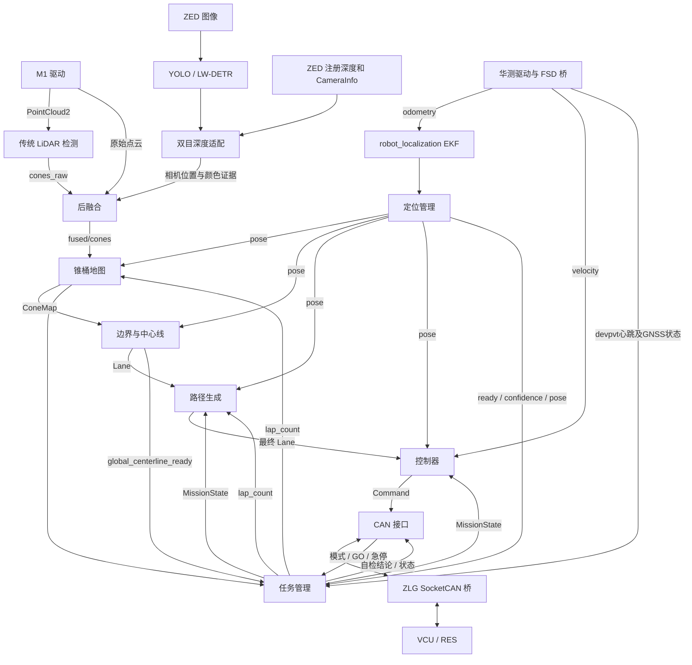

# 当前系统架构

> 核对：2026-10-13（同步10月12日工作）；入口依据 [start_full_fsd.sh](../start_full_fsd.sh)。详细定位见 [代码索引](CODE_MAP.md)。

## 1. 仓库边界

项目为 Formula Student Driverless 的 ROS 2 Humble 系统，提供实车感知、定位、建图、规划、控制、任务管理与 CAN 通信，以及隔离的仿真验证入口。

| 目录 | 职责及边界 |
| --- | --- |
| `WUTA-FSD/ros2_ws/src` | FSD 算法、消息、CAN 与第三方定位源码；Git 子模块 |
| `humble-chcnav-cgi_ros2pkg` | 华测通信解析、自定义消息及 FSD 坐标/速度桥；Git 子模块 |
| `zlgcan_bridge` | ZLG USB CAN 与虚拟 SocketCAN 双向桥、报文日志；Git 子模块 |
| `fsd-visualization-code` | RViz 配置、只读显示桥、安全图像插件 |
| `tools` | 配置审计、任务监控、启动监管、仿真适配、评估与回归 |
| `config` / `models` | 车辆与传感器外参、显示配置、机器相关推理引擎 |
| `docs` | 开发文档、专题记录与历史验证证据 |
| `.runtime` / `logs` / `log` | 运行状态、运行日志与构建产物；不能当作源码入口 |

外部依赖包含 ZED/RoboSense 已安装 overlay、GPU 推理依赖和 WUTA-SIM 已安装环境。复制此仓库不能自动得到全部驱动与模拟器。

## 2. 实车主链路

图中省略传感器自检、部分状态订阅与可视化边；完整核心接口见 [ROS_INTERFACE.md](ROS_INTERFACE.md)。

## 3. 默认运行节点

| 节点 / 可执行程序 | 当前入口行为 |
| --- | --- |
| 华测解析链、`chcnav_fsd_bridge` | 启动或 `--reuse-ins` 复用；输出里程计和车体速度 |
| `rslidar_sdk_node`、ZED 驱动 | 由 `fusion_modules_hardware.launch.py` 启动 |
| `yolov8_node` | 默认 Python YOLO/TensorRT；LW-DETR engine 可选 C++ 后端 |
| `stereo_detection_adapter_cpp` | 默认双目深度适配；Python 后端保留 |
| `lidar_detection_node`、`detection_fusion_node_cpp` | 默认传统检测 + C++ 后融合；Python 融合可选 |
| `ekf_node`、`localization_manager_node` | 全车模式启动；定位确认后再启动下游 |
| `cone_map_builder_node` | 输入 remap 到 `/perception/fused/cones` |
| `boundary_detector_node`、`path_generator_node`、`controller_node` | 全车模式启动 |
| `can_interface_node`、`mission_manager_node` | 全车模式启动；模式和 GO 来自真实 CAN |
| `monitor_mission.py` | 全车模式只读监控，输出变化时记录门控状态 |
| RViz / 显示桥 | 默认启动，`--no-rviz` 关闭 |
| KISS、sanitizer、NDT、map_saver | 有源码，但当前根实车入口不启动 |

`--sensor-only` 仍启动 CAN 硬件桥、惯导及感知；不启动车辆控制、任务管理和定位/建图/规划主链，显示固定到雷达帧。它会操作硬件，不能视为纯离线模式。

## 4. 状态与发布者所有权

`mission_manager` 唯一发布 `/system/mission_state`，并拥有正式 Trackdrive 圈次；`localization_manager` 发布标准 pose/ready/confidence；EKF 拥有动态 `odom -> base_link`；建图发布 ConeMap，边界节点发布中心线及验收结论，规划发布最终路径，控制器发布 Command。

急停允许 CAN 接口与任务机自检分别发布，同一话题采用锁存 QoS；不应因此复制 MissionState 或 lap_count 发布者。定位模式枚举 `LOC_KISS_ICP` 在当前实车配置中代表 EKF 输出分支，不能由名字推断 KISS 节点正在运行。

## 5. 仿真边界

[start_wuta_sim_validation.sh](../start_wuta_sim_validation.sh) 先加载外部模拟器，再加载当前 FSD overlay；[run_wuta_sim_validation.py](../tools/run_wuta_sim_validation.py) 组织测试。使用 EffortVehicle 适配开度、模拟 INS/相机检测和当前算法，独立 ROS domain，不启动真实 CAN 与传感器驱动。当前测试不启用 KISS。

模拟相机并不执行真实图像 YOLO，代理车辆也不是实车辨识模型。仿真通过不能替代 CAN、制动、真实感知及完整多圈验收。

## 6. 日志与诊断边界

运行目录由日志上下文组件创建，管理器或直接入口提供唯一管理日志写入者。
模块输出与结果通过路径参数进入统一目录，算法不负责移动运行目录。
未选赛项先记录 pending，进程停止并关闭文件后按实际赛项归档。
任务机产生权威门控诊断；只读监控和界面仅消费诊断，不反向控制任务。
监控异常只告警，车辆模块仍按原监管规则运行。详见 [运行日志](LOGGING.md)。

## 启动管理与GNSS边界（10月12日更新）

`fsd_startup`是Rich/Textual纯键盘前端，权限、预检查、ROS话题状态、日志与残留清理在单终端完成。部署通过根启动器执行，当前优先复用同接口唯一外部CAN桥，退出不清理外部桥。

惯导数据传输与定位质量分开：桥默认门槛0，任务机用devpvt判设备在线，另以GNSS门控决定任务推进；车检允许新鲜0或4，其他任务及RACE要求新鲜4。终端只订阅ROS数据，不额外读取串口。临时诊断在已有驱动内部采集，不改变串口读者数量。
