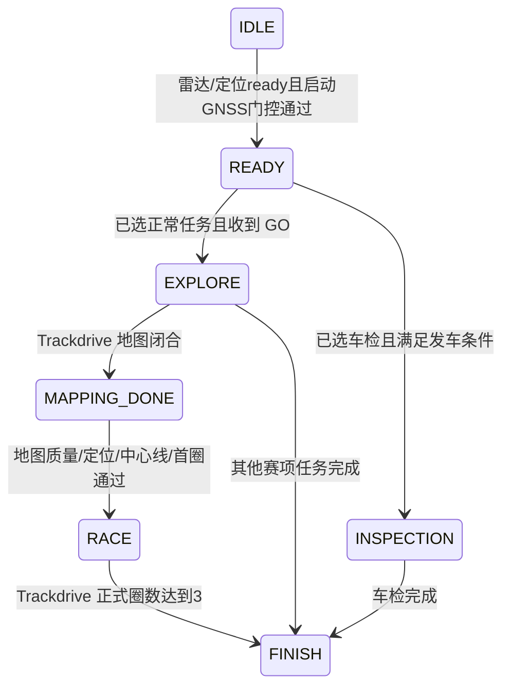

# 当前算法与状态设计

> 2026-10-13复核，同步10月12日工作树。本文解释已实现行为；迁移建议单独标识。

## 1. 检测与后融合

传统 LiDAR 检测执行去地面、体素下采样、欧氏聚类与几何筛选，深度学习 LiDAR 后端仍为占位。当前实车配置采用 M1 点云及 RANSAC，仿真验证会覆盖为适合模拟地面的参数。

相机检测默认 YOLO Python 节点，支持 TensorRT/PT/ONNX；LW-DETR engine 通过 C++ 节点。GPU 配置不应被理解为可无条件回退 CPU。双目适配使用注册深度和 CameraInfo，为框补充三维位置与协方差。

后融合以投影、时间与三维门控完成关联，保留颜色概率；相机引导聚类可从同帧真实原始点云中补充几何合格点簇。当前 `fusion.yaml`：`sync_slop_sec=0.03`、`max_wait_sec=0.1`、`min_color_probability=0.6`、`fuse_positions=false`、`publish_unmatched_lidar=false`、`guided_clustering=true`。增加等待并不等于放宽同步精度。

C++ 是当前默认融合与双目后端，Python 实现为备用；Python 单元测试不能单独证明 C++ 后端行为完全一致。红/橙调试旁路与正常地图累积功能不同，改变调试配置后需核对实际启动入口是否仍启动建图。

## 2. 锥桶地图

`ConeMapBuilder` 将检测按精确采样时间转换到 map，TF 暂不可用时缓存重试；按距离和语义兼容性关联轨迹，命中加权融合，同帧一轨迹最多匹配一检测，并合并兼容重复轨迹。最少命中、颜色投票与发布过滤在建图节点内完成。

上游语义优先；`assign_colors` 仅为未知色提供按传感器侧向位置的猜色兜底，融合配置应核对其关闭状态及颜色确认参数。map 分别保存五种颜色，红/蓝才是规划边界。

定位跳变保护清除待处理检测并冷却，避免错误位置被固化。闭环既使用正式圈次触发，也有累计距离、离开起点与几何回环条件；地图闭合后冻结并保存。静止噪声造成累计行程的问题已有额外离开起点约束，但不能因此推断所有噪声工况可靠。

建图使用两个 MutuallyExclusive callback group 分离位姿和检测整合，并使用 MultiThreadedExecutor。修改共享状态时需保留同步保护，不能按单线程回调假设删除锁。

## 3. 定位与 TF

当前实车以华测 odometry 约束 EKF 的绝对位置、姿态、纵向速度和 yaw rate，EKF 输出50 Hz并发布唯一动态车辆 TF。源码配置保留 sanitized KISS twist 输入，但根入口未启动其发布者。

定位管理按 MissionState.localization_mode 选择 EKF 或 NDT；检查有限位姿/协方差并产生 ready、confidence。FINISH 后停止转发位姿；EMERGENCY 后继续转发用于显示制动轨迹，但保持定位不可用。ready 当前不是对所有置信度、新鲜度和 NDT 门槛的综合判定。

可选 sanitizer 从 KISS 相邻位姿增量得到车体速度/yaw rate，拒绝非有限、异常间隔、超限及与 INS 不一致样本；不把 KISS 任意全局原点直接融合为绝对 pose。NDT 需要地图与初始位姿；map_saver 的 sensor→map 变换仍有 TODO，因此不能直接启用 NDT 比赛定位。

## 4. 路径与速度

Trackdrive 在 EXPLORE 由在线地图生成局部中心线，优先红蓝边界配对；不足时使用几何搜索兜底。黄橙锥不作为边界。地图闭合后进行全局排序和质量验收，成功后冻结有方向环线；几何兜底仍使用 ConeMap，不读取真值中心线。

规划从冻结环线切取前向40 m，按曲率 `v=sqrt(a_lat/|curvature|)`、可见长度、路径/定位置信度和圈次限速。当前规划上限第一圈7、第二圈9、第三圈10 m/s；起步前12 m限制3 m/s。当前控制器不叠加全局1 m/s限速；规划目标仍不等同于实测车速。

Skidpad 支持启动参考或绝对地图交叉点和进出锚点，右环两圈、左环两圈再退出停车。控制器用单调路径进度避免跳过自交叉段，当前 YAML 固定前视2.5 m。

Acceleration 支持 map 或 start_pose 锚定。当前 `anchor_frame=start_pose`，启动时冻结一次起步定位，把局部锚点转换为固定 map 路径。2026-10-13当前源码数值 entry/brake/stop 为0/10/20 m、速度1.5 m/s；文件中75 m/100 m、15 m/20 m等注释不是有效数值。恢复比赛几何需要明确修改配置并重新验证。

EBS 有独立路径参数（0.3/25/35 m、12 m/s）和模式分支；受自身规划配置及软件/硬件链约束。存在路径或模式不代表制动距离已通过验收。

规划在统一运行目录的 `trajectory/` 记录 planned/driven CSV，保留分片，赛项切换或重启另开 segments，避免覆盖；显示轨迹的平滑、抽样和跳变过滤只影响可视化，不回写定位或控制。

## 5. 控制与执行器

Pure Pursuit 提供横向目标，TwistFilter 约束转角、变化率与响应。Trackdrive 根据前方曲率调整3–5 m前视，避免把规划速度变化直接变成横向目标跳变。

纵向采用分赛项 PID，使用华测速度反馈。`simple_p` 和全局限速入口已移除；油门及制动分别由各赛项 `throttle.max_opening`、`brake.max_opening` 限幅，当前均为1.0。Inspection采用恒定开度和正弦转向，有独立时长配置，不能套用正常赛项速度闭环假设。

非法/空路径、非有限位姿/输出和定位超时触发零目标速度及回正；有效速度反馈下可由闭环给制动，反馈超时则中性开度。急停锁存后全零输出，不能将全零视为主动最大制动。当前 CAN 接口已恢复基线的周期发送逻辑，源码未实现历史文档中的0.5 s命令看门狗。

当前 CAN 配置使用 `steer.max_steer_angle`，没有历史版本的标定插值表和 calibration.enabled 参数；接口修改需核对实际打包、单位、符号和饱和范围。

## 6. 任务状态机

图省略所有状态均可能发生的急停/设备故障→EMERGENCY边。自检监控点云、原始惯导devpvt和图像心跳，启动宽限4 s，默认超时2 s。GNSS状态0不判设备故障；门控要求新鲜状态4，车检启动不设GNSS门槛，设备心跳自检独立保留。实际发车需模式已选择且 GO；默认 mission_mode 数值不代表已收到 VCU 选择。

任务机当前拥有：地图质量评估、定位质量/新鲜度门槛、NDT可选门槛、正式起终线计圈、状态迁移与传感器自检。RACE要求地图闭合、地图质量、全局中心线、定位门槛、首圈通过及新鲜GNSS状态4。正式计圈由定位建立有限起终线，并检查距离、时间、方向、横向范围和航向。

任务诊断使用 `description` 中的 `diag_version=2 wait=...`。等待原因由任务机提供，
RACE 判断与诊断复用同一组条件；发布诊断只读取状态。只读监控仅输出变化事件；
仅在启动前模式缓存不可用时，把首次观察到的赛项补写进 `run.json.mission`，
不维护赛项历史，不参与发车或状态迁移；它退出时只告警。完整职责见 [日志设计](LOGGING.md)。

## 7. 待演进事项

[任务机职责迁移说明](任务机职责迁移说明.md)是历史快照上的方案，不能当成当前完成状态：

| 事项 | 当前状态 |
| --- | --- |
| 雷达 ready 改用自检心跳 | 已实现，不再订阅悬空 lidar_ready |
| 定位综合 ready、定位模式决策迁入 localization | 未完成；任务机仍评估定位门槛并写定位模式 |
| 圈次从任务机迁入 localization | 未完成；lap_count 发布者仍是任务机 |
| 地图质量迁入 mapping 并输出结论 | 未完成；ConeMap 只有 is_closed，质量仍由任务机评估 |
| 解除建图对正式 lap_count 的依赖 | 未完成，当前仍订阅 |
| NDT 比赛定位完整集成 | 当前默认关闭；map_saver变换、地图和初始化需专项处理 |

迁移应同步修改发布者所有权、消息/话题、消费者、启动配置与验证，避免半迁移形成双发布者或环路。

### 固定路径启动锚定扩展（2026-10-13）

acceleration/skidpad（含当前U-turn）/ebs复用resolvePathReference和transformFixedPath：在所选参考系生成完整路径后执行p_map=p_start+R(yaw_start)p_local、yaw_map=wrap(yaw_start+yaw_local)，记录行执行相同变换。start_pose要求有效map姿态、定位ready和接收年龄≤0.5秒。新任务激活或赛项切换清本节点路径缓存，活动状态之间切换保持缓存。标准八字局部entry/crossing/brake/stop为0/15/30/40米，保持原几何距离；U-turn以局部entry为起点。map选项直接使用配置坐标。

Trackdrive局部中心线、全局前向窗口和正式计圈已使用真实位置/航向，保持map中的真实锥桶几何；只旋转最终路径会破坏对应关系。本次通过旋转/平移场景回归其行为，不新增第二套定位或计圈实现。

本次验证：path_generator最小构建通过；既有check_acceleration_start_pose.py已扩展并通过固定路径五种朝向、map兼容、定位等待、任务重锚定、路径冻结和planned CSV一致性，以及Trackdrive局部/全局旋转等价和后方路径拒绝。既有test_cone_colors_ros.py中5种朝向的全局锥桶中心线及计圈/错误航向拒绝共10项通过（计圈测试使用缩短距离/时间门槛）。均为隔离ROS输入测试，未启动硬件，未验收真实感知、车辆动力学、EBS制动距离或完整三圈实车表现。

## 10月13日变更与运行配置边界

固定路径共用启动参考转换、当前调试参数及未实施的末端停车建议见[今日工作记录](工作记录_2026-10-13.md)。16:47运行快照stop=15m不是当前源码stop=20m，不能混用。

## 静态制动台架（2026-10-21）

CLI M键选择当前会话的台架运行配置，根入口统一向controller、mission_manager、can_interface传递brake_bench_mode；默认false。任务机通过MissionState同名字段声明真实运行模式，仍唯一拥有发车与完成状态。台架限定MISSION_ACCELERATION，IDLE/READY只等待真实选档和之后的GO，豁免GNSS、雷达、定位发车条件及传感器持续检查；原始ready/status不伪造为真，自检结论明确表示台架豁免，向CAN提供首份发送授权。

controller在普通路径/PID检查前执行静态动作：steady_clock计算活动状态进入后的延时和保持时间，Command.speed/angle始终0，纵向仅为0或负指定开度；配置保存在controller.yaml。无需pose/waypoints/速度反馈，因此静止台架也能产生制动。publishZeroCommand原本调用零速PID，不能保证严格中性；台架改用明确零开度。结束先发中性再发布一次mission_complete，由任务机切FINISH；之后持续中性。延时/保持不被重复状态或路径广播重置。未观察到等待状态的活动中重启、模式不一致、急停或任务状态超时均不产生或续做动作。

台架CAN只消费Command和任务状态，对正驱动/转向进行协议边界限制；持续新鲜的台架EXPLORE、自检ok及新鲜Command才允许转发制动，500ms超时在100ms周期归中性，正常运行模式保留原转发规则。正常析构发中性，根清理顺序为先停controller、保留CAN0.7秒后按原进程生命周期清理。停机、丢包和硬件故障仍不能等价于已证明电机释放。

## 人工驾驶记录运行策略（2026-10-22）

人工记录是部署配置，不增加感知/定位算法或第二套任务状态机。正常日志写入者及path_generator实际轨迹记录复用；任务机manual_record_mode仅禁止自动任务推进/选档/GO/完成，设备自检与急停沿原机制保留。IDLE/EMERGENCY均允许定位及实际轨迹继续流动，不伪造任务运行或控制字段。CAN接口receive_only和ZLG桥--receive-only分别约束ROS发送出口和硬件发送出口，默认关闭，正常与台架行为保持；同一进程只收属性不可由运行时参数修改。参数由CLI选择的根启动配置显式覆盖，不写入模块常驻YAML作为日后正常运行默认。

2026-10-22台架前置协议：在原can_interface的RES变化沿处理内，消费任务机的新鲜acceleration/READY及台架自检结论，先发送0x603/DLC8的A=`2B 71 60 00 18 FC FF FF`、B=`2B 40 60 00 1F 00 00 00`，按A/B交替三组。六次写入成功后再沿原GO出口放行，使原任务机活动迁移之后才开始原5秒等待，不在CAN另加业务计时器。每次运行仅尝试一次序列，失败中止后续发送并锁存急停，不发布GO、不自动重试；重复GO不会重复前置动作。SocketCAN写入成功与电机应答确认不同，本次未增加SDO应答解析。

2026-10-23：暂时停用GO前置0x603序列，保留prepareBrakeBench函数但注释调用。原任务机仍处理选档和GO，controller原有5秒中性等待、10秒50%制动、中性释放保持；没有另加或重复5秒等待。原0x210协议及0x301心跳保持，不直接操作制动电机对象字典。

### 感知传输与处理边界（2026-10-25）

雷达与相机相关输入统一Reliable/Volatile，减少大点云/图像在Best Effort接收路径中的丢样。雷达检测保留KeepLast(1)，相机输入及标注图保留深度5，融合和任务机保留深度5；算法、几何估计及结果所有权不变。

相机仍使用最新图像槽、适配20帧缓存、10 ms匹配容差和50 ms等待。可靠传输与算法处理覆盖率是两个约束：不扩大队列积压旧扫描/图像，不承诺推理过载时逐帧处理，验证应同时检查接收帧率、算法处理覆盖率及帧龄。接口见[ROS_INTERFACE](ROS_INTERFACE.md#感知链路-qos2026-10-25)。
