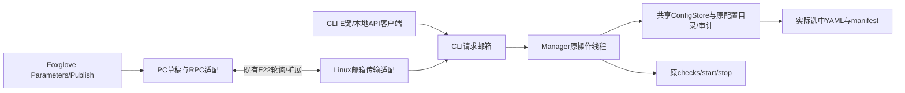

# Foxglove参数面板与CLI统一管理接口

2026-10-20，按方案1实现：配置读写归CLI所有，Foxglove经既有无线链路调用同一接口；检查、启动、停止复用Manager。依据标准入口 `start_fsd_manager.sh` → `fsd_startup/manager.py` → `start_full_fsd.sh` 和各launch源码核对。仅本机源码实现与人工阅读，未运行测试、WSL、构建或实机操作，未改动现场YAML。

## 结论

Foxglove原生Parameters用于读取和编辑草稿，原生Publish按钮提交保存、检查、启动、停止、查询状态与丢弃草稿后重新读取。PC WebSocket已公告Parameters；Linux无线适配器只写CLI请求邮箱，不另建配置写入器或进程管理器。

CLI清单中的11个核心模块与标准全车入口使用同一批源码YAML。原模块配置页仍读取manifest审计快照；新增E键编辑页与无线接口直接读取所选文件，共享扩展至18项的目录清单。不能把“同一源文件”“上次检查值”“启动覆盖后的值”“算法当前采用值”混为一项。

## 核心模块对照

下表路径相对 `WUTA-FSD/ros2_ws/src`。均已进入 `tools/check_fsd_module_configs.py:manifest` 的files和parameters。

| CLI模块键 | 文件 | 标准全车入口的消费方式 |
| --- | --- | --- |
| controller | `control/controller/config/controller.yaml` | controller_node的--params-file；--controller-config可换文件 |
| can | `system/can_interface/config/can_interface.yaml` | can_interface_node的--params-file；--can-config可换文件 |
| camera | `perception/camera_detection/config/camera_detection.yaml` | 模块感知launch给检测节点传参；model_path有显式覆盖 |
| adapter | `perception/camera_detection/config/stereo_adapter.yaml` | 模块感知launch给双目适配节点传参 |
| lidar | `perception/lidar_detection/config/lidar_detection.yaml` | 模块感知launch给检测节点传参 |
| fusion | `perception/detection_fusion/config/fusion.yaml` | 模块感知launch给融合节点传参 |
| mapping | `mapping/cone_map_builder/config/cone_map_builder.yaml` | cone_map_builder_node的--params-file，另覆盖地图保存路径 |
| boundary | `planning/boundary_detector/config/boundary_detector.yaml` | boundary_detector_node的--params-file |
| planning | `planning/path_generator/config/path_generator.yaml` | path_generator_node的--params-file，另覆盖record.run_dir |
| ekf | `localization/localization_manager/config/ekf.yaml` | ekf_node的--params-file，另覆盖debug_out_file |
| mission | `system/mission_manager/config/mission_manager.yaml` | mission_manager_node的--params-file |

根入口显式把config_root设为FSD源码src目录；感知节点由 `perception/detection_fusion/launch/fusion_modules_hardware.launch.py` 加载上述camera/adapter/lidar/fusion文件。即使launch本身来自安装包，这个显式参数仍指向源码配置；但Linux安装的launch若未更新，不能只凭Windows源码证明其一致。

## 额外接入的配置

| 文件（相对主仓库） | 实际用途 | 原11模块审计快照范围（新增编辑器均已接入） |
| --- | --- | --- |
| `WUTA-FSD/ros2_ws/src/perception/detection_fusion/config/rsm1_hardware.yaml` | RoboSense驱动config_path | 审计函数读取它检查点云话题，但未放进files/parameters |
| `WUTA-FSD/ros2_ws/src/perception/detection_fusion/config/zed_hardware.yaml` | ZED驱动ros_params_override_path | 未列入11模块 |
| `humble-chcnav-cgi_ros2pkg/src/chcnav/config/chcnav_fsd_bridge.yaml` | 惯导解析/桥/日志配置 | 未列入11模块；根启动会额外留配置快照 |
| `config/camera_lidar.yaml` | 相机雷达外参，支持CALIBRATION/--calibration覆盖 | 预检查另行检查；不是模块清单的一项 |
| `config/base_to_zed.yaml` | base_link到ZED的静态外参，支持BASE_TO_ZED/--base-to-zed覆盖 | 预检查另行检查；不是模块清单的一项 |
| `fsd-visualization-code/src/fsd_visualization/config/topics.yaml` | 显示话题、坐标系与轨迹显示设置 | 不在11模块参数中 |
| `fsd-visualization-code/radio_link/radio.yaml` | 无线端口、调度预算和显示配置 | 不在CLI模块参数中，Linux/Windows各自读取本地副本 |

`localization_manager_node`在根入口没有单独加载模块YAML；`ekf.yaml`属于EKF，不应标成该节点专用配置。

根全车入口没有启动KISS/NDT，也没有加载旧 `perception/config/field_tuning.yaml`。这些文件存在不表示当前生效；独立旧感知入口与根入口须分别核对。

## 快照、覆盖和实际生效值

1. `fsd_startup/checks.py:configuration`调用现有manifest函数，传入controller-config、can-config、MODEL和CAN_IFACE等选择。
2. `manager.py:checks`把检查结果写入 `.runtime/fsd_manager/manifest.json`。
3. 终端 `terminal_ui.py:refresh_config/content` 和图形 `dashboard.py:refresh`读取这个JSON，不重新执行参数审计。终端已有“不代表节点在线加载值”的提示。
4. 原YAML被外部修改后，旧manifest不会自动更新；需再次预检查。再次预检查也不能证明已经运行的节点重新读取了文件。
5. 根启动另生成当次 `configs/module_config_manifest.json` 和输入YAML副本；这是部署输入证据，也不是ROS在线参数查询结果。

明确覆盖项：

- `--controller-config`、`--can-config`可替换默认文件；CLI与根脚本均接收这些选项。
- 相机MODEL/--model覆盖model_path；清单把部署选择单独列出。
- CAN_IFACE可覆盖can.device；清单也单列部署选择。
- EKF debug_out_file、建图map_save_path、规划record.run_dir由当次运行目录覆盖。
- 惯导根入口显式传--port/--log-dir；串口可能由INS_PORT或--ins-port覆盖，而非完全遵循惯导YAML。--reuse-ins时原惯导进程不重新加载。
- ZED publish_tf、publish_map_tf在根入口显式关闭。
- sensor-only不启动定位/建图/规划/控制/任务，并从显示topics.yaml生成当次副本，关闭这些显示输入；清单含参数不表示模块正在运行。

## 使用方式（无线0.7.0）

两端更新源码后重启CLI、Linux无线发送端和Windows接收端。导入 `fsd-visualization-code/radio_link/foxglove_layout.json`，打开“CLI 控制与参数”页，无需自定义Foxglove扩展。

1. Linux保留CLI常驻。终端菜单：`bash start_fsd_manager.sh --menu --skip-build`；无终端：`bash start_fsd_manager.sh --headless --menu --skip-build --no-rviz`。使用原现场部署选项，远程启动沿用这些选项；只有--menu才避免管理器打开后立即启动。
2. Linux无线程序独立常驻，沿用原native/bridge模式和E22串口。CLI停止FSD时保留管理器和遥测采集，无线程序由独立终端管理，才能再次远程启动。
3. Parameters的 `selection/module` 填模块键；可用键见 `meta/modules`。初始读取controller；每次选择新模块才传该文件，已读取模块缓存在PC。
4. 编辑 `yaml/<模块>/<完整YAML路径>`，这是本机草稿。`meta/dirty_count`为草稿参数数；切换模块不会丢弃草稿，可一起修改controller与can等关联配置。
5. 点击“保存配置”，按各模块revision组装一次事务，由Linux CLI串行执行类型检查、有限数、既有跨模块一致性校验、备份、原子替换和manifest刷新。Linux返回成功后才清除相应草稿；不会自动停止或重启。
6. “检查”“启动”“停止”调用Manager原操作。“启动”成功表示子进程流程已提交；是否完成全栈检查看phase和实时日志。“停止”清理该CLI登记的FSD进程，保留CLI；它不等同于旧的 `start_fsd_manager.sh --stop`（清理并退出管理器）。
7. “查询CLI状态”读取检查结果与运行状态；“丢弃草稿并重新读取”明确丢弃PC草稿、刷新文件revision。提交失败时草稿保留，文件被外部修改需重新读取并编辑。

所有Foxglove客户端共享同一个PC接收进程的草稿缓存。`meta/*`只读，状态错误在 `meta/status` 和 `/radio/cli/control` 显示。CLI重启会清空旧缓存/草稿，重新获取新boot下的文件；临时断链不自动提交或重试新的操作。PC与Linux系统时间需同步；PC只允许源时间10秒内且接收8秒内的在线CLI状态发起请求，未来偏差超过5秒同样视为离线。

## 参数与结果字段

| 字段 | 含义 |
| --- | --- |
| `selection/module` | 可修改的模块选择；不是YAML参数 |
| `yaml/<模块>/<路径>` | 文件原层级，JSON Pointer转义，保留ROS节点段/ros__parameters；修改暂存PC |
| `meta/modules` / `meta/loaded_modules` | 当前可用模块与已缓存模块 |
| `meta/<模块>/source` | Linux实际选中的绝对路径 |
| `meta/<模块>/revision` | 原始文件SHA256；保存要求匹配，防止覆盖他人修改 |
| `meta/<模块>/restart_required` | 保存后尚未确认相关进程重新加载；保守持久保留，不凭启动返回清除 |
| `meta/online` / `meta/status` | CLI心跳可用性及操作/保存结果 |
| `meta/last_request_id` / `meta/last_action_ok` | 最近操作的Linux返回结果；不是串口ACK |
| `/radio/cli/control` | boot、run、phase、running、active、last、pending、草稿数与完整操作result/error |

结果中的 `source_stamp_ns` 为Linux执行结束的Unix纳秒字符串；CLI控制快照用Linux心跳源时间，内嵌结果保留自己的执行源时间。PC本地草稿数/排队文字属于显示元数据，不是新的Linux样本。未加入ROS runtime/effective参数查询；不宣称算法已热更新。MODEL、CAN_IFACE、INS_PORT、运行输出目录和ZED TF等启动覆盖仍按前述规则优先。

18项模块键：controller、can、camera、adapter、lidar、fusion、mapping、boundary、planning、ekf、mission、rslidar、zed、ins、camera_lidar、base_to_zed、visualization、radio_linux。缺失文件在目录中标available=false，不阻止其他模块读取。radio_linux只改Linux副本，需重启无线进程；Windows副本不随远程保存同步，改变串口/量化/链路参数前需配套维护双端配置。

## CLI本地编辑与共享API

Textual菜单按E打开编辑器，选择模块/参数，输入JSON值，Tab选择“暂存此参数”并Enter，最后“保存全部草稿”。可在多个模块中积累草稿；Esc关闭，未提交草稿丢弃，已提交请求继续由Manager完成。JSON字符串必须加双引号。原配置审计页保留，保存会更新manifest。

逐行/无界面模式可从主仓库根目录调用：

```bash
python3 fsd_startup/control_api.py cli.status
python3 fsd_startup/control_api.py config.list
python3 fsd_startup/control_api.py config.read --module controller
python3 fsd_startup/control_api.py cli.check
python3 fsd_startup/control_api.py cli.start
python3 fsd_startup/control_api.py cli.stop
python3 fsd_startup/control_api.py cli.result --request-id <原始32位请求ID>
```

`config.set --updates`接收JSON列表，每项为 `{"module":"controller","revision":"<read返回的SHA256>","changes":{"/<完整路径>":1.2}}`。多个模块放在同一列表校验。此客户端也只投递邮箱，不直接执行进程或写YAML。超时后查原ID，不能据“未收到结果”断言操作未执行。

## 实现与协议边界



- CLI所有者：`fsd_startup/control_api.py`处理 `.runtime/fsd_manager/control/inbox/<id>.json`；同目录results存持久结果，heartbeat.json由轻量线程每秒刷新。业务始终在Manager.pump原线程执行，心跳线程不做启动/停止/配置保存。
- `fsd_startup/config_store.py`复用 `tools/check_fsd_module_configs.py:configuration_files/manifest`。仅可编辑目录内既有标量和标量数组，数组不改长度；不新增/删除键，不支持null、别名、merge key、重复键或特殊YAML类型写入。标量位置补丁保留注释与层级；备份和事务记录保存在control/transactions，未完成事务启动时回滚，外部并发修改冲突会报错供人工处理。
- 类型与现有审计约束会检查；这不等于每个驱动/算法参数都有完整业务范围校验。保存额外驱动或显示文件也不证明运行进程已读取。多文件事务逐文件原子替换，Manager内部串行；外部绕过CLI的读取者可能看见提交中间态，改动相关配置时应统一经CLI管理并在完成后重启。
- 无线 `cli_control.py` 是传输/缓存适配，`rpc.py` 是有界分块：JSON最大256KiB，zlib压缩后每块144字节再base64，最多8个在途请求/回复，每块应用ACK、2秒重传，传输/执行等待约180秒。复用单条512字节扩展，不增加串口读者或第二条无线通道。
- 扩展body类型 `cli_rpc` / `cli_rpc_ack`，含id、dir(request/reply)、i，数据块另含n、data。块ACK只证明重组/投递，不代表业务执行完成；最终 `ok/result/error` 才是CLI执行结果。
- 统一操作：cli.status、cli.result、cli.check、cli.start、cli.stop、config.list、config.read、config.set。请求含32位UUID、CLI boot、expires_ns、source_stamp_ns；stop另绑定当前run。执行前持久化executing标记，同ID不再次执行；若CLI执行途中崩溃，返回结果未知，不擅自再次启动。持久请求/结果不要在有在途指令时清理。
- `cli_control`新增独立心跳消息，目标每2秒，和日志/几何共享3000 UART B/s预算。配置只按需读取；大配置传输会临时占用原扩展时隙并降低其他数据实际刷新率，不承诺固定分配比例。
- 默认仅本机WebSocket/TCP入口；收到请求只调CLI固定操作/目录，不接受任意shell命令或任意文件路径。不增设GO、赛项切换、油门、制动或转向业务出口。

按用户要求，本版仅完成源码修改、文档和人工审查，未执行自动测试、WSL、构建、串口或实车验证。两端与CLI必须配套升级；本机代码更新不代表Linux已部署或功能已在线生效。

## 0.7.1指令优先级

指令与参数批量读取已分离：cli.check/start/stop/status/result及config.set使用独立高优先级无线队列，分块ACK、重传和最终成功/失败回复保持相同优先级；config.list/read及其ACK/回复使用普通扩展队列。RPC数据最多占6/8个在途名额，指令可使用保留的2个名额。优先级标记是RPC外层可选p=1/0，不改变原请求内容、hash、持久去重与源时间。

无线下一个分片顺序为：指令队列 → 日志落盘ACK → 运行选择 → 原日志/普通扩展/加权数据调度。CLI邮箱同样先处理待执行指令，指令之间按到达顺序，不把stop与start相互重排；当前已在执行的CLI操作和已发出等待确认的无线帧不会被强行中断。普通参数回复或数据FIFO满不再阻挡新指令入队。总带宽预算和主从轮询保持，指令期间数据发送机会会减少。

需配套更新两端无线与CLI并重启，旧Linux仍会按旧调度发送回复。升级前等现有操作完成；接收程序退出不会撤销已到Linux的指令。`/radio/link.command_queue`是独立指令待发数，extension_queue是普通数据待发数。源码已补回归用例但按要求未运行。

## 0.7.2 CLI状态面板

“CLI 控制与参数”顶部新增原生背景Indicator，读取PC派生display_state：运行/通过为绿色，等待操作/FSD已停止为蓝色，检查/构建/启动为橙色，失败为红色，等待心跳/离线为灰色。直接消费CLI原phase，不另判全栈就绪；心跳过期覆盖为离线，原phase仍保留在详情。只需重启Windows接收程序并导入新版布局，Linux及无线字段无需变化，不增加带宽。

## 当前页面划分：CLI操作与参数控制分离

“CLI 日志与传感器”右侧的/radio/cli/dashboard.rows表格区域顶部包含CLI状态指示、检查、启动、停止和查询CLI状态；原车辆/任务表保留在下方。完整日志仍在左侧，日志传输和操作结果详情位于左侧下部。

原“CLI 控制与参数”页已更名“参数控制”，只放Parameters、保存配置、丢弃草稿并重新读取；参数保存结果看meta/status。本文早前版本章节中的旧页名属于历史布局。此次只改布局，不改RPC操作、优先级或源时间；无需重启接收端或Linux，导入新版JSON即可。
