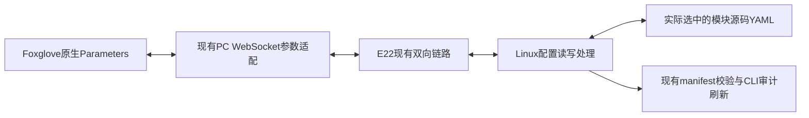

# Foxglove参数面板：配置来源核对与接入设计

2026-10-20，依据本仓库标准入口 `start_fsd_manager.sh` → `fsd_startup/manager.py` → `start_full_fsd.sh` 和各launch源码核对。本次只读审计与方案设计，没有连接Linux查询正在运行的进程/参数，未修改算法配置或实现远程写入。

## 结论

Foxglove原生Parameters可以充当参数读写界面，但它是数据源的参数客户端，不是通用YAML文件编辑器。必须在现有PC WebSocket服务和Linux文件所有者之间补充参数读写桥。

CLI清单中的11个核心模块与标准全车入口使用同一批源码YAML。CLI界面读取的是预检查保存的manifest快照；它没有实时打开所有YAML、没有查询ROS在线参数，也没有编辑保存接口。不能把“同一源文件”“上次检查值”“启动覆盖后的值”“算法当前采用值”混为一项。

## 核心模块对照

下表路径相对 `WUTA-FSD/ros2_ws/src`。均已进入 `tools/check_fsd_module_configs.py:manifest` 的files和parameters。

| CLI模块键 | 文件 | 标准全车入口的消费方式 |
| --- | --- | --- |
| controller | `control/controller/config/controller.yaml` | controller_node的--params-file；--controller-config可换文件 |
| can | `system/can_interface/config/can_interface.yaml` | can_interface_node的--params-file；--can-config可换文件 |
| camera | `perception/camera_detection/config/camera_detection.yaml` | 模块感知launch给检测节点传参；model_path有显式覆盖 |
| adapter | `perception/camera_detection/config/stereo_adapter.yaml` | 模块感知launch给双目适配节点传参 |
| lidar | `perception/lidar_detection/config/lidar_detection.yaml` | 模块感知launch给检测节点传参 |
| fusion | `perception/detection_fusion/config/fusion.yaml` | 模块感知launch给融合节点传参 |
| mapping | `mapping/cone_map_builder/config/cone_map_builder.yaml` | cone_map_builder_node的--params-file，另覆盖地图保存路径 |
| boundary | `planning/boundary_detector/config/boundary_detector.yaml` | boundary_detector_node的--params-file |
| planning | `planning/path_generator/config/path_generator.yaml` | path_generator_node的--params-file，另覆盖record.run_dir |
| ekf | `localization/localization_manager/config/ekf.yaml` | ekf_node的--params-file，另覆盖debug_out_file |
| mission | `system/mission_manager/config/mission_manager.yaml` | mission_manager_node的--params-file |

根入口显式把config_root设为FSD源码src目录；感知节点由 `perception/detection_fusion/launch/fusion_modules_hardware.launch.py` 加载上述camera/adapter/lidar/fusion文件。即使launch本身来自安装包，这个显式参数仍指向源码配置；但Linux安装的launch若未更新，不能只凭Windows源码证明其一致。

## 当前CLI没有完整列出的配置

| 文件（相对主仓库） | 实际用途 | CLI清单覆盖情况 |
| --- | --- | --- |
| `WUTA-FSD/ros2_ws/src/perception/detection_fusion/config/rsm1_hardware.yaml` | RoboSense驱动config_path | 审计函数读取它检查点云话题，但未放进files/parameters |
| `WUTA-FSD/ros2_ws/src/perception/detection_fusion/config/zed_hardware.yaml` | ZED驱动ros_params_override_path | 未列入11模块 |
| `humble-chcnav-cgi_ros2pkg/src/chcnav/config/chcnav_fsd_bridge.yaml` | 惯导解析/桥/日志配置 | 未列入11模块；根启动会额外留配置快照 |
| `config/camera_lidar.yaml` | 相机雷达外参，支持CALIBRATION/--calibration覆盖 | 预检查另行检查；不是模块清单的一项 |
| `config/base_to_zed.yaml` | base_link到ZED的静态外参，支持BASE_TO_ZED/--base-to-zed覆盖 | 预检查另行检查；不是模块清单的一项 |
| `fsd-visualization-code/src/fsd_visualization/config/topics.yaml` | 显示话题、坐标系与轨迹显示设置 | 不在11模块参数中 |
| `fsd-visualization-code/radio_link/radio.yaml` | 无线端口、调度预算和显示配置 | 不在CLI模块参数中，Linux/Windows各自读取本地副本 |

`localization_manager_node`在根入口没有单独加载模块YAML；`ekf.yaml`属于EKF，不应标成该节点专用配置。

根全车入口没有启动KISS/NDT，也没有加载旧 `perception/config/field_tuning.yaml`。这些文件存在不表示当前生效；独立旧感知入口与根入口须分别核对。

## 快照、覆盖和实际生效值

1. `fsd_startup/checks.py:configuration`调用现有manifest函数，传入controller-config、can-config、MODEL和CAN_IFACE等选择。
2. `manager.py:checks`把检查结果写入 `.runtime/fsd_manager/manifest.json`。
3. 终端 `terminal_ui.py:refresh_config/content` 和图形 `dashboard.py:refresh`读取这个JSON，不重新执行参数审计。终端已有“不代表节点在线加载值”的提示。
4. 原YAML被外部修改后，旧manifest不会自动更新；需再次预检查。再次预检查也不能证明已经运行的节点重新读取了文件。
5. 根启动另生成当次 `configs/module_config_manifest.json` 和输入YAML副本；这是部署输入证据，也不是ROS在线参数查询结果。

明确覆盖项：

- `--controller-config`、`--can-config`可替换默认文件；CLI与根脚本均接收这些选项。
- 相机MODEL/--model覆盖model_path；清单把部署选择单独列出。
- CAN_IFACE可覆盖can.device；清单也单列部署选择。
- EKF debug_out_file、建图map_save_path、规划record.run_dir由当次运行目录覆盖。
- 惯导根入口显式传--port/--log-dir；串口可能由INS_PORT或--ins-port覆盖，而非完全遵循惯导YAML。--reuse-ins时原惯导进程不重新加载。
- ZED publish_tf、publish_map_tf在根入口显式关闭。
- sensor-only不启动定位/建图/规划/控制/任务，并从显示topics.yaml生成当次副本，关闭这些显示输入；清单含参数不表示模块正在运行。

## Parameters面板设计（待实现）

原生面板适合按模块展示数值、布尔、字符串和数组。将YAML中的配置项映射为有类型的参数，保留ROS节点段及ros__parameters路径；驱动的非ROS结构单独解析。不要把全部YAML作为一大段字符串让用户手工编辑。

建议明确分组：

| 分组 | 含义 |
| --- | --- |
| yaml/<模块>/<参数路径> | Linux当前选中文件的值，可修改保存 |
| meta/<模块>/source | 当前实际文件路径，只读 |
| meta/<模块>/revision | 文件内容版本，用于发现与CLI/磁盘修改冲突 |
| meta/<模块>/restart_required | 修改是否待重启生效，只读 |
| effective/<模块>/<参数路径> | 已知启动覆盖后的值，标明覆盖来源 |
| runtime/<节点>/<参数> | 未来按需查询的ROS参数值，只读起步；不等同于算法内部已经采用值 |

UI只写yaml分组；保存成功反馈“Linux已保存，待重启生效”。只有算法具备明确热更新机制、回读与运行验证时，才能标成“运行中已应用”。标准控制器、路径规划、建图、边界、任务等实现主要在构造时读取参数并保存成员/算法实例，未发现通用参数回调把后续修改应用到内部配置。ROS参数服务即使接受新值，也不能据此宣称算法热更新成功。

建议沿用一个配置目录清单：扩展现有 `tools/check_fsd_module_configs.py` 的文件选择与交叉校验，让CLI与无线配置处理共用；不要另外硬编码一份容易漂移的YAML列表。磁盘写入由Linux侧配置所有者统一处理，PC仅缓存和转发。

数据流程：

当前PC仅公告ClientPublish，未实现Parameters的get/set/subscribe处理；Linux扩展上行只是转发到 `/fsd_radio/extension/rx`，仅Ping有内置Pong，没有YAML读写处理。仅在布局里增加Parameters面板不能自动完成上述流程。

接入时应有的行为：

- 按模块按需读取、分页返回；使用现有参数类型，不连续广播全部配置。
- 现有扩展单条消息上限512字节，配置清单或大数组需应用层分页/分块；不能直接塞入整份manifest。
- 修改发送参数名、新值、请求ID和期望文件revision；Linux按当前路径目录清单定位文件，不接收任意路径。
- 校验类型、有限数和既有跨模块约束（例如控制器与CAN最大转角一致、感知话题一致）；失败返回具体原因。
- 修改涉及互相约束的多个模块时成组校验，避免一次保存造成半套不一致配置。
- 校验后备份并原子保存，保留YAML注释和原有层级；更新CLI审计清单，保存结果回传。
- 请求ID支持超时查询和重复请求去重；只有收到Linux持久化结果才能显示保存成功，串口ACK/本机排队不算保存成功。
- 配置保存不隐式重启进程，也不默认在线改写驾驶算法；明确显示待重启状态。

本节为接入设计，不代表上述参数读写已实现。当前仅完成源码路径核对，未运行测试、WSL或硬件验证。

参考：[Foxglove Parameters](https://docs.foxglove.dev/docs/visualization/panels/parameters)。PC已安装SDK 0.29.2的websocket.ServerListener提供on_get_parameters、on_set_parameters和订阅回调，可在现有服务上扩展，无需自定义面板。
