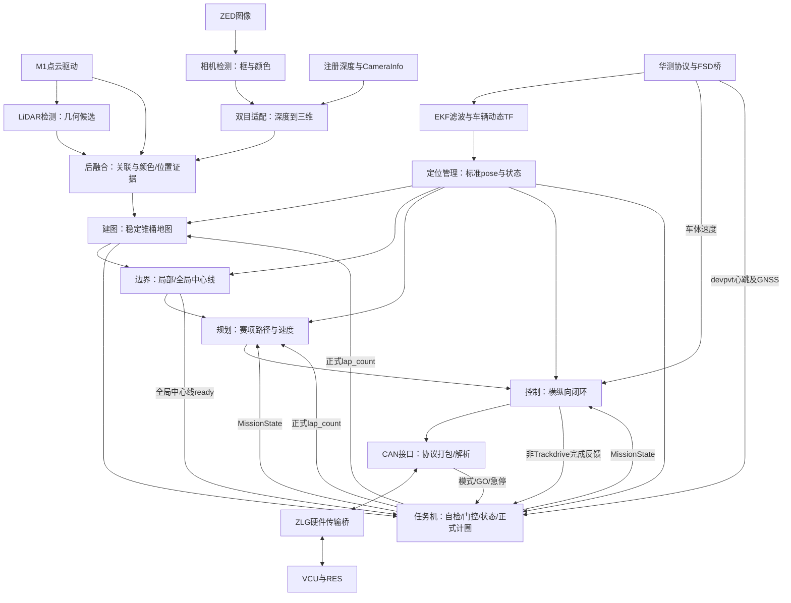

# WUTA2026_FINAL 模块职责分析报告


核对日期：2026-10-13。范围：`/home/wuta/WUTA2026_FINAL` 当前工作树。

用户已确认将模块对应文件、功能、复用入口及权责整理进 [ARCHITECTURE.md](ARCHITECTURE.md)，并落实根AGENTS和接手指南的任务前阅读约定；具体调参值不纳入正式架构。本报告保留详细分析及当时的源码配置快照，不表示批准或完成算法职责迁移。**第13节覆盖 `WUTA-FSD/ros2_ws/src` 全部17个ROS包及共享目录，细化到文件、关键函数、执行流程、配置与复用边界。**

## 1. 结论与核对方法

系统已按“硬件接入 → 感知 → 定位/建图 → 规划 → 控制 → CAN执行”分离。另有任务状态机、启动监管、日志、显示和仿真支撑层。主要问题不是缺少模块，而是部分业务判定仍集中在任务机、可选实现与当前运行链容易混淆，以及少量备用接口和旧配置尚未对齐。

本次先阅读已有 `ARCHITECTURE`、`CODE_MAP`、`ROS_INTERFACE`、`DESIGN`、`DEVELOPMENT` 和 `AGENT_GUIDE`，再核对根启动脚本、实际感知 launch、模块 YAML、关键节点的发布/订阅和业务函数、相关 CMakeLists。代码事实以当前入口和实现为依据；历史文档作为背景。

- FSD 源码有 **17 个 ROS 包**，包括算法包、消息包、第三方定位包及空壳工具包。
- 华测源码中有 `chcnav`、`msg_interfaces`，另嵌入第三方 `serial` 包；显示源码有两个 ROS 包。
- 默认实车、sensor-only、仿真、独立 launch分别有不同启用范围，不能用“目录存在”推断“正在运行”。
- 这是静态结构与职责分析，未启动硬件、未构建或运行仿真；不宣称现场节点、性能或安全行为已验收。第三方源码按接入边界分析，没有逐行审计其全部内部实现。

## 2. 根目录及部署层的职责

| 目录/入口 | 实际职责 | 边界与修改位置 |
| --- | --- | --- |
| `WUTA-FSD/ros2_ws/src` | FSD 感知、定位、建图、规划、控制、任务与 CAN 的源码和消息契约 | 算法改动进入对应包；是独立 Git 子模块 |
| `humble-chcnav-cgi_ros2pkg` | 华测通信、协议解析、FSD odometry/velocity 适配与设备数据日志 | 管理惯导输入；是独立 Git 子模块 |
| `zlgcan_bridge` | ZLG USB CAN 与 SocketCAN 双向传输、报文记录、VCU 模式会话缓存 | 管理硬件传输；是独立 Git 子模块 |
| `fsd-visualization-code` | RViz 展示、算法消息到显示消息的转换、安全图像插件 | 显示消费算法结果，不生成驾驶决策 |
| `fsd_startup` | 键盘管理界面、预检查、启动/停止操作、已登记进程清理、会话日志 | 委托根脚本启动车辆，不另写一套车辆状态机 |
| `tools` | 配置审计、日志采集、诊断格式化、仿真评估与专项工具/测试 | 工具应调用现有模块或消费其结果，避免另建生产链 |
| `config` | 实车车辆→相机及相机→雷达外参、部分显示配置资产 | 当前根入口默认读取这里的物理外参；算法参数主要在各包 config |
| `models` | 本机模型/推理引擎资产 | 是否使用取决于相机模块配置或显式模型选项；engine 依赖本机运行环境 |
| `docs`、`README_FULL_FSD.md` | 当前架构/接口/部署说明、专题与历史证据 | 历史验收不能代替当前源码确认 |
| `.runtime` | PID、锁、管理器状态等运行元数据 | 运行产物，不是算法配置或源码 |
| `build`、`install`、`log`，各工作空间的同名目录 | 编译产物、安装 overlay 和构建日志 | 修改源码后构建；不直接修改安装副本来交付功能 |
| `logs` | 管理会话、赛项运行记录、模块日志、快照、轨迹和验证结果 | 保留历史证据；算法节点不拥有运行目录搬移权 |
| `.rollback_backups`、`.pytest_cache`、Git 元数据 | 回退备份、测试缓存与版本管理 | 不作为新的实现入口 |

入口的分工如下：

| 入口 | 实际行为 |
| --- | --- |
| [start_full_fsd.sh](../start_full_fsd.sh) | 环境与依赖检查、按需构建、CAN/惯导复用或启动、TF及感知启动、等待首帧、启动下游算法与任务机、监管所属进程组 |
| [start_fsd_manager.sh](../start_fsd_manager.sh) | 进入 `fsd_startup/manager.py`，提供操作前端；全栈部署仍调用根脚本 |
| `start_full_fsd.sh --sensor-only` | 启动 CAN 硬件桥、惯导、感知及可选显示；不启动 EKF、建图、规划、控制、任务机。此模式仍连接硬件 |
| [start_wuta_sim_validation.sh](../start_wuta_sim_validation.sh) | 加载外部模拟器与当前 FSD overlay，在独立 ROS domain 运行仿真工具；不启动真实传感器和 CAN 桥 |
| [run_wuta_sim_regression.sh](../run_wuta_sim_regression.sh) | 批量组织已有故障/噪声场景，调用仿真入口并汇总结果 |

根入口默认采用 M1、ZED、华测、传统 LiDAR 检测、自动选择的相机检测后端、C++ 双目适配、C++ 后融合、EKF、定位管理、建图、边界、规划、控制、CAN 和任务机。KISS、sanitizer、NDT、map_saver 不在该默认链中。

## 3. 主要数据流



此图省略显示、诊断和部分状态边。消息方向不等于完整启动时序：定位管理先在默认 EKF 分支提供 pose，根脚本收到 pose 后启动下游及任务机，不能为“先有任务状态”随意增加启动等待。

## 4. 感知模块

下表 FSD 路径相对 `WUTA-FSD/ros2_ws/src/`。

| 模块与实现 | 输入 → 输出 | 当前职责及边界 |
| --- | --- | --- |
| M1/ZED 外部驱动；`perception/detection_fusion/launch/fusion_modules_hardware.launch.py` | 设备 → 点云、图像、注册深度、CameraInfo | launch 负责加载驱动及各感知模块 config，并发布相机→雷达静态外参；不实现检测算法 |
| `perception/lidar_detection/src/lidar_detection_node.cpp`、`traditional_detector.cpp` | 原始点云 → `/perception/lidar/cones_raw` | 距离过滤、去地面、体素化、聚类、尺寸筛选，输出单帧几何锥桶候选；不累计世界地图、不做正式计圈 |
| 同包 `dl_detector.cpp` | 预留深度学习检测接口 | 构造函数明确抛出“未实现”异常；不能把 YAML 切到 dl 当作可用替代 |
| `perception/camera_detection/camera_detection/yolo_node.py`、`yolo.py` | 左目矫正图像 → `/camera/yolo/cones`、标注图像和检测状态 | 模型加载、预处理、推理、后处理与颜色证据；支持 PT/ONNX/engine 路径，具体模型由配置选择；不直接形成地图 |
| 同包 `src/lwdetr_tensorrt_node.cpp` | 图像 → 同类检测接口 | LW-DETR engine 的 C++ 后端；构建依赖 CUDA/TensorRT/OpenCV，默认 launch 仅对匹配的 engine 自动选用 |
| 同包 `src/stereo_detection_adapter_cpp.cpp`、`camera_detection/{adapter,stereo}.py` | 框+注册深度+CameraInfo → `/perception/camera/cones` 与转发 CameraInfo | 时间/光学帧匹配、框内深度估计、三维位置和协方差；无有效深度时保留颜色证据，默认 C++ |
| `perception/detection_fusion/src/detection_fusion_node_cpp.cpp`、`detection_fusion/{node,core}.py` | LiDAR候选+相机检测+CameraInfo+原始点云+TF → `/perception/fused/cones`、状态 | 按时间、投影和三维距离关联颜色/几何证据，含相机引导点云聚类；默认 C++，Python 是另一后端 |
| 同包 `detection_fusion/calibration.py` 与物理外参 YAML | 外参文件 → 统一变换定义/静态TF参数 | 读取、校验相机雷达标定契约；当前根入口默认选择根 `config/camera_lidar.yaml`，不能只改包内示例期待实车生效 |

感知内部的聚类看似重复，实际输入条件不同：LiDAR 检测是在点云中独立找候选，融合中的 guided clustering 是借相机证据补找遗漏候选。它们是互补机制；若要共享底层实现，应先确认参数与输出语义，不能直接删除其中一支。

感知只生成单帧观测；跨帧确认、颜色投票和稳定地图应在建图层维护。若需要增加新模型，优先扩展相机模型/后端接口，沿用 `CameraConeDetectionArray`、双目适配和后融合。

## 5. 定位、坐标与建图模块

| 模块与实现 | 输入 → 输出 | 当前职责及边界 |
| --- | --- | --- |
| 华测 `HcMsgParserLaunchNode.cpp`、`HcCgiProtocolProcessNode.cpp` | 串口等设备字节 → 解码后的设备消息，包含 `/chcnav/devpvt` | 单一设备读取链、帧/CRC/协议解析；现有诊断计数在该链内部采集，监控不应另开串口读数据 |
| 华测 `ChcnavFsdBridge.cpp` | devpvt → `/chcnav/odometry`、`/chcnav/velocity` | 经纬度转局部坐标、姿态偏置、ENU速度转车体速度、协方差与有效值过滤；不发布车辆 TF、不决定发车。默认 GNSS 过滤门槛为0，自动原点在状态4固定 |
| `localization/robot_localization` 的 `ekf_node` | 华测odometry，以及配置保留的可选 sanitized KISS twist → `/odometry/filtered`、`odom→base_link` | 第三方状态滤波；当前车辆动态TF的唯一来源。当前配置保留KISS输入不代表根入口启动KISS |
| `localization/localization_manager/src/localization_manager.cpp` | EKF或NDT+MissionState → `/localization/pose`、ready、confidence | 按任务机给出的 localization_mode 选择分支，检查有限值并转发标准位姿；不发布正式圈次。EKF分支把 frame 标为map，依赖当前 map/odom 同原点关系 |
| `localization/kiss-icp` | 可选点云 → KISS里程计 | 第三方点云里程计能力；根实车入口不启动，独立 `localization.launch.py` 会启动它 |
| `localization/kiss_icp_wrapper/src/kiss_odom_sanitizer_node.cpp` | KISS位姿增量等 → sanitized车体速度/yaw rate | 检查异常增量/间隔/速度，避免把任意KISS全局原点当绝对定位；默认实车不启动 |
| `localization/ndt_localization/src/ndt_localization.cpp` | 点云地图+初始位姿+点云 → NDT pose/path/aligned_cloud | 可选地图匹配定位；默认实车不启动，需要独立完成地图、点云接口与初始化接入 |
| 同包 `map_saver.cpp` | 点云/里程计/任务状态 → 点云地图及 `/ndt/map_ready` | 点云地图保存；sensor→map变换仍有TODO，不能当成已验收的建图来源 |
| `mapping/cone_map_builder/src/cone_map_builder.cpp` | fused cones（入口remap）+pose+正式lap_count+TF → ConeMap、Marker、保存地图 | 按采样时间变换到map、跨帧关联、融合位置、命中/颜色确认、合并重复轨迹、定位跳变冷却、闭合与冻结 |

**三种“地图/质量”应分清：**

1. ConeMap 是结构化锥桶地图，由 `cone_map_builder` 维护；点云地图是 NDT 使用的另一种资产。
2. 建图节点的命中、颜色和最低闭合条件负责“哪些观测值得入图、能否冻结”。
3. 任务机的红蓝数量、平均置信度、颜色平衡负责“现有地图是否允许进入 RACE”。边界模块另外验收“能否形成合格闭合中心线”。三者并非同一个质量布尔值。

建图同时支持正式圈次触发闭合和几何回环兜底；几何回环不是第二个正式圈次发布者。当前建图不订阅 MissionState，因此并没有随赛项切换重置地图的统一协议；这也是后续会话生命周期设计需要说明的边界。

## 6. 规划与控制模块

| 模块与实现 | 输入 → 输出 | 当前职责及边界 |
| --- | --- | --- |
| `planning/boundary_detector/src/boundary_detector_node.cpp` | ConeMap+pose+MissionState → `/planning/centerline`、全局ready、path_confidence、Marker | Trackdrive红蓝边界配对、局部中心线、几何搜索兜底、闭合后的全局排序和质量验收，冻结有方向环线；黄橙锥不作为正常红蓝边界 |
| 同包 `thirdparty/pathplanning` | 几何点集 → 几何搜索/路径候选 | 已有Delaunay与路径搜索支持层；新几何需求先检查该实现，不另复制一套第三方算法 |
| `planning/path_generator/src/path_generator_node.cpp` | 中心线、pose、任务状态、圈次和置信度 → `/planning/final_waypoints` | 最终可执行路径与速度剖面：Trackdrive前向窗口/曲率及质量限速/分圈限速/起步距离；Skidpad、Acceleration、EBS固定或锚定路径；含调试U-turn分支 |
| 规划节点中的记录函数 | 最终规划、pose、华测速度、Command → planned/driven CSV、轨迹显示 | 记录统一目录下 `jrajectory` 的业务数据、赛项/重启分段；显示平滑不修改真实定位或控制输入 |
| `control/controller/src/controller_node.cpp` | final_waypoints+pose+华测velocity+MissionState+emergency → `/control/command`、非Trackdrive任务完成反馈 | 控制循环、按赛项配置、输入失效处理、停车完成判定、车检动作；不重新生成锥桶地图/中心线或决定RACE迁移 |
| 同包 `pure_pursuit.cpp` | 车辆状态+最终路径 → 前视目标、转角和目标速度 | 横向跟踪与路径进度；Skidpad保持单调进度避免自交叉跳段，Trackdrive按前视目标采用速度 |
| 同包 `twist_filter.cpp`、`include/controller/speed_pid.hpp` | 横向目标、目标速度和实测速度 → 滤波转角及油门/制动开度 | 横向变化率/响应约束与分赛项纵向PID；油门、制动分别限幅；当前没有 simple_p 或全局1 m/s限速入口 |

**中心线、最终路径、控制命令是三级不同产品：** 边界模块回答“赛道怎么走”，规划回答“本赛项走哪段、每点目标速度是多少”，控制回答“此刻需要什么转角和开度”。新限速策略优先归规划；跟踪误差、PID与转角动态归控制；报文定标和字节布局归CAN。

边界模块可能为中间 Lane 设置速度字段，但控制器订阅的是规划生成的 final_waypoints；最终驾驶速度剖面的出口属于 `path_generator`。控制器计算曲率用于调整前视，不等于复制规划的曲率限速。

## 7. 任务机与 CAN 的分工

| 模块 | 当前负责 | 不应重复实现的权责 |
| --- | --- | --- |
| `system/mission_manager/src/mission_manager.cpp` | 模式选择与GO消费、状态迁移、传感器心跳自检、GNSS启动/RACE门控、地图质量门槛、定位质量/新鲜度门槛、可选NDT门槛、正式起终线计圈、Trackdrive结束及权威等待诊断 | 正式 MissionState、lap_count、DevicesInspection；展示工具不得另作发车判定或发布第二份状态 |
| `system/can_interface/src/can_interface.cpp` | SocketCAN收发、Command定标/打包、在线/完成位、设备心跳帧、VCU模式解析/重发、RES GO边沿与急停发布 | CAN协议转换及硬件输入的ROS表达；不重新运行PID、地图质量判定或赛项状态机 |
| 同包 `can_socket.cpp` | SocketCAN的底层打开/非阻塞收发 | 可复用传输实现；协议业务仍在can_interface |
| 同包 `mode_cache.cpp` | 校验ZLG会话/PID/启动身份/接口等，恢复有效VCU模式 | 是缓存消费者；不恢复GO或急停，不证明VCU当前在线 |
| ZLG `main.c`、`can_side.c`、`zlg_side.c` | SocketCAN与ZLG设备双向搬运原始CAN帧 | 不生成驾驶Command，不参与任务迁移 |
| ZLG `mode_cache.c`、`can_log.c`、`logger.c` | 缓存真实收到的模式、协议帧日志、桥运行日志 | 是模式缓存生产者和传输证据所有者 |

任务机当前职责较宽，但现有发布者是明确的。`docs/任务机职责迁移说明.md` 描述的是待演进方案；正式圈次、地图质量和综合定位门槛尚未按方案迁出，不能先改文档宣称已完成。

CAN的两个发送层也不是重复：`can_interface` 负责业务编码，ZLG负责硬件传输。两端模式缓存实现是生产/消费关系。GO仍是变化沿事件，禁止用缓存/界面模拟“恢复GO”。

控制帧首次发送的条件是“收到第一份自检结论”，结论为false也会打开该发送门；心跳帧从节点启动即发送。当前CAN会保存并周期发送最近的Command，没有命令超时看门狗；控制器急停输出为全零，不能将其解释为主动满制动。这是当前能力边界，不是本报告已补齐的功能。

## 8. 公共契约、启动工具与显示层

### 8.1 公共消息

| 包 | 用途 | 边界 |
| --- | --- | --- |
| `common/wuta_msgs` | Cone/ConeArray/ConeMap、相机检测、MissionState、DevicesInspection等 | 业务契约与枚举定义；不是算法或任务机实现 |
| `common/autoware_msgs` | Lane、Waypoint、Command等规划/控制消息 | 规划→控制→CAN的共享契约 |
| 华测 `msg_interfaces` | 原始设备协议消息 | 设备表达经FSD桥转换到通用消息，避免下游遍布协议解析 |
| `common/wuta_tools` | 预留ROS公共工具包 | 当前CMake只有依赖声明及TODO，无实际工具源码/目标；当前已实现工具主要在根tools中 |

核心约定：颜色 RED=0、YELLOW=1、BLUE=2、ORANGE=3、UNKNOWN=4；相机概率长度5；速度m/s；Command.angle为度、正角向左；throttle_brake范围[-1,1]。检测保留采样时间和帧，不能用最新pose替代历史检测的精确时间TF。

### 8.2 启动管理子模块

| 文件 | 负责 |
| --- | --- |
| `fsd_startup/manager.py` | 操作会话、执行预检查、调用根入口、收集输出、登记所属进程、停止与日志收尾；失败返回菜单，不自动重启控制 |
| `checks.py` | 模块配置、依赖/资产、串口占用、雷达网卡、CAN设备/外部桥占用、显示和安装产物预检查 |
| `runtime_checks.py` | 从根入口进度输出和诊断更新运行检查展示；进程启动、已收到消息、任务获准发车是不同结论 |
| `terminal_ui.py` | Rich/Textual键盘交互与显示；业务操作委托Manager |
| `dashboard.py` | ROS只读遥测、设备/参数/模块日志展示；不增加串口读者、不发布驾驶状态 |
| `processes.py` | PID+启动身份确认、后代进程定位、信号与精确清理；不全局杀ROS |
| `privilege.py` | 提权命令与环境适配 |
| `log_context.py` | RunLog目录、配置快照、run.json、停止后的赛项归档；仅文件系统生命周期，不控制硬件 |
| `autostart.sh`、`window.sh`、`install_ui.sh` | 管理器自启/窗口入口与界面依赖安装 |

预检查和根脚本的启动验证有所重叠，这是不同调用路径/阶段的防线；统一语义应复用配置审计和现有检查，避免增加第三套互相冲突的判断。

### 8.3 根 tools 的复用清单

| 需求 | 已有实现 |
| --- | --- |
| 查模块配置、话题衔接、控制器/CAN最大转角及参数有效性 | `check_fsd_module_configs.py` 的 `manifest`；管理器checks和根脚本已使用它 |
| 保存本次实际配置及部署资产 | `snapshot_run_configs.py`，配合RunLog及模块配置manifest |
| 枚举可调参数/发现声明与配置 | `audit_algorithm_parameters.py`；结果不是运行时参数覆盖层 |
| 直接入口的管理输出采集 | `run_logged.py`；管理器直接拥有日志时不再套第二个写入者 |
| 提权子进程组监管 | `run_privileged_group.py` |
| 展示任务等待原因/GNSS含义 | `mission_diagnostics.py`、`gnss_status.py`；消费任务机权威诊断 |
| 运行中任务只读监控与赛项历史 | `monitor_mission.py`；只拥有mission_history.json，不修改任务状态或run.json |
| 检查直线起步锚点/惯导速度 | `check_acceleration_start_pose.py`、`check_chcnav_velocity_replay.py` |
| 隔离仿真编排与开度车辆适配 | `run_wuta_sim_validation.py`、`wuta_sim_effort_vehicle.py` |
| 仿真路径距离/结果汇总/几何复核 | `sim_metrics.py`、`summarize_wuta_sim.py`、`review_sim_geometry.py` |
| 回归验证 | tools中的test文件、fsd_startup测试、FSD包内test、ROS颜色/日志回归及显示测试；选与变更相关的已有测试 |

### 8.4 可视化

`fsd_visualization/bridge.py` 将ConeMap、ConeArray、Lane、pose、速度等真实算法消息转为独立显示话题；`configuration.py` 根据topics配置生成RViz布局。`view.launch.py` 启动显示桥和可选RViz，不启动FSD算法。`fsd_rviz_plugins/src/safe_image.cpp` 负责图像显示插件。

算法包内Marker、规划driven轨迹和显示桥轨迹是显示用途的不同输出，不宜当成第二份地图/定位。它们可以合理共存，显示优化不应回写到驾驶链。

## 9. 当前权威输出与所有权

下表限于默认实车生产链；仿真和专项测试可在独立运行环境中提供替代输入。

| 结果/资源 | 当前所有者 | 使用原则 |
| --- | --- | --- |
| `/system/mission_state`、正式`/system/lap_count` | mission_manager | 其他模块消费，不重复发布 |
| `/system/devices_inspection`、权威wait诊断 | mission_manager | CAN和界面消费，界面不重新计算一套放行规则 |
| `/localization/pose`、ready、confidence | localization_manager | 下游统一订阅；综合RACE门槛目前仍由任务机评估 |
| 动态`odom→base_link` | EKF | 防止ZED/KISS等额外发布同一TF边 |
| 静态`map→odom`、`base_link→zed_camera_link` | 根启动入口 | 物理外参/全局坐标策略改变时联动定位与TF |
| 相机光学帧→雷达静态外参 | 实车感知launch | 读取当前选定的相机雷达标定文件 |
| `/chcnav/velocity` | 华测FSD桥 | 实车控制速度来源；CAN轮边速度代码当前未启用 |
| `/mapping/cone_map`及is_closed | cone_map_builder | 不能在融合/显示另维护权威地图 |
| 中心线、global_centerline_ready、path_confidence | boundary_detector | 规划和任务机消费验收结论 |
| `/planning/final_waypoints` | path_generator | 最终路径与速度出口 |
| `/control/command` | controller | 控制器唯一执行指令出口 |
| 非Trackdrive `/system/mission_complete` | controller | 向任务机反馈完成；Trackdrive正式结束归任务机圈次 |
| 模式/GO的ROS表达 | can_interface | 来源于真实VCU/RES；GO不缓存、不自动重放 |
| `/system/emergency` | CAN与任务机自检两路事件源 | 有意支持多故障源，消费者锁存；不是一般业务状态双所有者 |
| 运行目录生命周期与run.json | 管理器或直接入口采集器，使用RunLog | 同一运行只有一个生命周期所有者，模块只写分配给自己的数据 |
| 管理日志manager.log | 管理器或run_logged采集器 | 本次运行唯一管理输出写入路径；节点模块日志另属各模块 |
| ZLG模式缓存 | ZLG写入，CAN接口读取 | 消费者不能伪造硬件历史或把GO写入模式缓存 |

## 10. 职责重叠、缺口与易误判项

| 项目 | 已核实的现状 | 建议处理方式（本轮未修改） |
| --- | --- | --- |
| 任务机职责较宽 | `coneMapQualityPasses`、`raceGates`、`updateLapCounter`仍在mission_manager；localization_manager只做部分输出校验/状态 | 先在架构记录当前所有权。若决定迁移，再一起修改发布者、消息、消费者、启动与验证，禁止只迁一半 |
| ready的含义 | localization_manager接受有限EKF输出就发布ready=true，并由协方差算confidence；没有独立周期超时降ready的完整策略；任务机另查RACE定位门槛 | 文档明确“定位输出可用”与“赛项获准进入RACE”的差别；不能直接将ready当作所有质量条件通过 |
| Python/C++备用后端不完全等价 | Python双目adapter写死输出话题，C++读取output_topic/output_info_topic；当前默认值相同，但改配置后Python不会跟随 | 若需要切换/维护Python后端，在原adapter补齐契约并验证；不新增第三个适配节点 |
| 显示速度接口落后 | 默认显示topics.yaml仍用`/localization/velocity`，实车控制使用`/chcnav/velocity` | 修正显示配置并核对当前share/源码加载路径，无需新增速度桥来掩盖接口差异 |
| 仿真与最新惯导门控的适配待核对 | 本地仿真runner仍覆盖mission的imu_topic为odometry；当前任务机实际用ins_heartbeat_topic订阅devpvt并据此查GNSS。本地runner没有显式创建devpvt发布者 | 核对外部模拟器是否输出所需devpvt/GNSS；若没有，应在仿真适配层补齐契约。静态证据不足以断言当前仿真一定成功或失败，旧通过记录需重新验证 |
| 跨赛项地图生命周期 | path_generator在模式切换时清自己的路径/记录；cone_map_builder不订阅MissionState，boundary只更新模式/状态，已冻结环线无对应统一重置入口 | 若要求同一进程跨赛项/重跑复用，先设计一次会话的reset契约；仅日志支持多赛项不等于所有算法状态都能重置 |
| 同名定位模式造成误解 | 枚举LOC_KISS_ICP及日志写KISS+EKF，但根入口只启EKF与定位管理；独立localization.launch又会启KISS | 按入口注明启用范围，不能根据枚举名改算法去“补启动KISS” |
| CAN缺少命令超时保护 | sendControlFrame复用最近Command周期发送；当前没有历史描述的命令看门狗 | 写明当前限制；若另行授权实现，归CAN传输失效策略并联动控制/VCU验证，不在界面补发归零 |
| 旧入口/旧统一配置 | 保留fusion_hardware/fusion_mapping等launch、field_tuning.yaml、包内示例、根显示配置等；默认入口读取有特定来源 | architecture列出有效入口与资产来源；先核对launch实际加载，不能同时叠加旧统一调参 |
| 未完成能力 | DLDetector构造抛异常；wuta_tools无目标；NDT map_saver坐标变换TODO | 标为占位/专项未接入，不作为默认可复用成品；要实现就在现有对应模块内补齐 |
| 中性输出与制动 | 急停全零Command不表示满制动，CAN发送门也不等于自检通过 | 记录真实软件职责及硬件接口边界，避免文档声称存在未实现的保护 |

合理的分层检查不等于重复造轮子：规划控制目标速度，控制限制实际输出，CAN处理协议饱和；建图验收观测，边界验收中心线，任务机决定赛项迁移。复用应以语义和输入输出相同为判断依据。

## 11. 文档整合建议与落实范围

已按用户确认，将模块文件/功能、复用入口与权责整理进 `docs/ARCHITECTURE.md`；详细源码索引仍在 `CODE_MAP.md`、话题/单位/QoS在 `ROS_INTERFACE.md`。以下保留初次报告的整合建议，具体数值快照只作分析记录，不作为正式架构中的调参表。

正式架构至少应包含：

1. 仓库/部署层与算法包的边界，默认、可选、占位模块区分。
2. 主要数据流及中心线→最终路径→控制指令三级接口。
3. 每个模块的输入、输出、职责与不能越权的业务。
4. 权威发布者、TF、正式圈次、设备自检、诊断及日志生命周期所有权。
5. 参数/外参/显示资产的实际加载来源，源码与install副本边界。
6. 当前职责未迁移项、可选定位和备用实现的能力限制。
7. 新需求的复用路径与开始工作前的阅读约定。

**已新增根 `AGENTS.md`，并对齐 `docs/AGENT_GUIDE.md`、`DEVELOPMENT.md`及文档入口的接手顺序。** 首次分析时项目未发现适用的AGENTS.md；根AGENTS现在作为任务前阅读入口，架构为模块职责说明来源。

建议约定文本：

> 开始任何代码、配置、启动或文档修改前，先阅读 docs/ARCHITECTURE.md 与 docs/CODE_MAP.md，涉及跨模块接口时补读 docs/ROS_INTERFACE.md。先定位现有实现、权威生产者与消费者、当前启动入口及实际配置来源，再确定改动所属模块。优先扩展或复用现有模块，不新增重复节点、重复状态机或第二个权威发布者。职责/接口发生变化时，同步更新架构、接口和代码索引。

该约定不要求每个普通代码任务额外等待批准；架构职责调整按用户当次授权执行。本次交付是文档整合与阅读约定，不包含执行上表建议的算法重构或硬件操作。

## 12. 关键源码依据

- [实车根入口](../start_full_fsd.sh)：实际启动范围、先后顺序、config与remap、TF和进程监管。
- [模块化感知launch](../WUTA-FSD/ros2_ws/src/perception/detection_fusion/launch/fusion_modules_hardware.launch.py)：后端选择、驱动、物理外参及模块config加载。
- [配置审计manifest](../tools/check_fsd_module_configs.py)：共享参数与感知话题衔接的已有检查。
- [任务机实现](../WUTA-FSD/ros2_ws/src/system/mission_manager/src/mission_manager.cpp)：状态迁移、地图质量、GNSS/定位门槛、正式圈次与诊断。
- [定位管理实现](../WUTA-FSD/ros2_ws/src/localization/localization_manager/src/localization_manager.cpp)：实际pose/ready/confidence及模式选择行为。
- [建图实现](../WUTA-FSD/ros2_ws/src/mapping/cone_map_builder/src/cone_map_builder.cpp)：采样时间TF、关联、投票、圈次/几何闭合与冻结。
- [边界实现](../WUTA-FSD/ros2_ws/src/planning/boundary_detector/src/boundary_detector_node.cpp)：中心线、全局验收与冻结。
- [规划实现](../WUTA-FSD/ros2_ws/src/planning/path_generator/src/path_generator_node.cpp)：最终路径/速度、赛项切换与记录。
- [控制实现](../WUTA-FSD/ros2_ws/src/control/controller/src/controller_node.cpp)：驾驶/车检分支、Command与完成反馈。
- [CAN接口实现](../WUTA-FSD/ros2_ws/src/system/can_interface/src/can_interface.cpp)：协议与发送门、周期发送、模式/GO/急停和缓存读取。
- [华测FSD桥](../humble-chcnav-cgi_ros2pkg/src/chcnav/src/chcnav_fsd_bridge/ChcnavFsdBridge.cpp)、[ZLG桥](../zlgcan_bridge/main.c)：硬件适配与业务CAN之间的边界。
- [启动管理](../fsd_startup/manager.py)、[日志上下文](../fsd_startup/log_context.py)、[任务诊断展示](../tools/mission_diagnostics.py)：编排、日志与只读展示的所有权。
- [Python双目适配](../WUTA-FSD/ros2_ws/src/perception/camera_detection/camera_detection/adapter.py)、[C++双目适配](../WUTA-FSD/ros2_ws/src/perception/camera_detection/src/stereo_detection_adapter_cpp.cpp)：备用接口差异。
- [显示话题配置](../fsd-visualization-code/src/fsd_visualization/config/topics.yaml)、[仿真runner](../tools/run_wuta_sim_validation.py)：旧速度接口和新惯导门控适配待核对项。

报告中“当前负责”是源码事实；“建议”须按后续批准的范围实施；“待核对”不作为已复现故障。

## 13. FSD/ros2_ws/src 逐包详细分析

本节所有简称路径均相对 `WUTA-FSD/ros2_ws/src`。这里的 `src` 是ROS工作空间的包集合；各包内部的 `src` 才是C++实现目录。Python包的主实现通常在同名Python目录，`scripts`只是可执行包装入口。`include`保存类型、接口与状态声明，`config`保存参数，`launch`负责组装节点，`CMakeLists.txt`决定实际构建/安装目标。不是每个目录都对应一个独立运行节点。

### 13.0 包结构与启用范围

```text
src/
├── common/
│   ├── wuta_msgs                 业务消息与枚举
│   ├── autoware_msgs             路径和控制消息
│   └── wuta_tools                公共工具空壳
├── perception/
│   ├── lidar_detection           点云几何候选
│   ├── camera_detection          图像检测与注册深度适配
│   ├── detection_fusion          后融合与感知组装入口
│   ├── calibration               标定模板/资料（非ROS包）
│   └── config                    历史共享调参（非ROS包）
├── localization/
│   ├── robot_localization        第三方EKF/UKF等
│   ├── localization_manager      标准定位输出管理
│   ├── kiss-icp                  第三方ICP源码，ROS包位于ros/
│   ├── kiss_icp_wrapper           KISS增量过滤及接入参数
│   └── ndt_localization           可选NDT与点云地图保存
├── mapping/cone_map_builder       锥桶地图与闭合
├── planning/
│   ├── boundary_detector         边界/中心线及几何支持库
│   └── path_generator            赛项最终路径与速度
├── control/controller            控制、车检
└── system/
    ├── mission_manager           任务、自检、门控、正式计圈
    └── can_interface             ROS/CAN协议与SocketCAN
```

| ROS包 | 构建/安装的主要运行入口 | 默认实车状态 |
| --- | --- | --- |
| wuta_msgs / autoware_msgs | 生成C++/Python消息绑定，无运行节点 | 所有业务节点依赖 |
| wuta_tools | 无运行目标 | 空壳，未提供工具能力 |
| lidar_detection | lidar_detection_node | 传统后端启用 |
| camera_detection | yolov8_node、yolov8_onnx_node、stereo_detection_adapter、stereo_detection_adapter_cpp、条件构建的lwdetr_tensorrt_node | 当前配置选择Python YOLO + C++双目；ONNX命名入口也调用同一个Pythonmain |
| detection_fusion | detection_fusion_node、detection_fusion_node_cpp | C++后端启用 |
| robot_localization | ekf_node、ukf_node、navsat_transform_node、robot_localization_listener_node | 仅EKF进入默认链 |
| localization_manager | localization_manager_node | 启用 |
| kiss_icp（kiss-icp/ros） | odometry_component及注册生成的kiss_icp_node | 默认根入口不启动 |
| kiss_icp_wrapper | kiss_odom_sanitizer_node | 默认根入口不启动 |
| ndt_localization | ndt_localization_node、map_saver_node | 默认根入口不启动 |
| cone_map_builder | cone_map_builder_node | 启用 |
| boundary_detector | boundary_detector_node，内部静态pathplanning库 | 启用，但只为Trackdrive生成中心线 |
| path_generator | path_generator_node | 启用，按任务选择路径分支 |
| controller | controller_node；另有两个测试程序 | 启用，普通/车检/标定按状态和开关分支 |
| mission_manager | mission_manager_node | 启用 |
| can_interface | can_interface_node、can_socket库 | 启用 |

下列配置数值是本次补充读取的**源码快照**，显式启动覆盖、运行参数与后续编辑可能改变它们；没有读取现场进程参数来确认其已生效。

### 13.1 common/wuta_msgs：感知、地图与任务的契约

源码依据：[消息定义目录](../WUTA-FSD/ros2_ws/src/common/wuta_msgs/msg)、[构建定义](../WUTA-FSD/ros2_ws/src/common/wuta_msgs/CMakeLists.txt)。

| 文件 | 定义的职责 |
| --- | --- |
| Cone.msg | 三维位置、颜色编号、confidence；UNKNOWN默认4。位置帧由外层header解释 |
| ConeArray.msg | 一个来源/采样时刻的锥桶数组；提供统一header，不提供地图轨迹ID |
| CameraConeDetection.msg | detection_id、像素框、五类颜色证据、confidence、可选三维位置及3×3协方差 |
| CameraConeDetectionArray.msg | 曝光时刻与矫正左目光学帧下的检测数组 |
| ConeMap.msg | map帧下按五类颜色组织的锥桶及is_closed；不含正式lap_count、地图质量结论或reset会话ID |
| MissionState.msg | 状态、赛项和定位枚举，header与description；枚举名称不能证明某定位程序已启动 |
| DevicesInspection.msg | ok与设备故障名列表，供任务机→CAN及观察工具使用 |

**执行方式：** `rosidl_generate_interfaces`生成序列化和语言绑定，没有独立运行循环。检测→适配→融合→地图通过这些消息交接；状态机与控制/规划通过MissionState交接。

**复用与变更边界：** 新检测后端优先沿用现有消息；改变颜色顺序、数组长度或字段要联动全部发布/订阅者、保存地图、显示、仿真和旧rosbag。不要为同一Cone/任务状态在另一个包创建第二套略有差异的消息。跨节点诊断当前放在description，格式已有消费者，不可只当普通日志任意修改。

**已有验证：** 工作空间级 `ros2_ws/test/test_cone_colors_ros.py` 检查编号/默认色以及融合、地图、边界和任务机间的颜色链；本轮未运行。

### 13.2 common/autoware_msgs：规划到执行的契约

源码依据：[消息定义目录](../WUTA-FSD/ros2_ws/src/common/autoware_msgs/msg)。

`Waypoint.msg`将PoseStamped与TwistStamped放在同一航点；`Lane.msg`用header和Waypoint数组表示路径；`Command.msg`包含header、speed、angle、throttle_brake。该包只生成消息，不包含Autoware完整规划/控制栈。

**交接流程：** boundary输出中间Lane → path_generator输出最终Lane → controller计算Command → can_interface编码开度和角度。速度m/s、转角deg、正开度驱动/负开度制动的含义来自现有生产/消费实现；msg中float64本身不会执行单位检查。CAN纵向字段读取throttle_brake，不将speed直接当油门。

**复用边界：** 新控制器或路径分支应接入这三级契约，不绕过controller从规划器直接发执行器指令。消息变更要重建所有受影响包和外部SIM消费者。

### 13.3 common/wuta_tools：预留包

源码依据：[CMakeLists.txt](../WUTA-FSD/ros2_ws/src/common/wuta_tools/CMakeLists.txt)。

只有package.xml和CMakeLists，声明ament_cmake/rclcpp/wuta_msgs，保留“add sources and targets”TODO，没有src/include、可执行目标或库。它目前不承担根 `tools/` 中配置审计、日志、监控或仿真功能。

**复用边界：** 不应因为名字是公共工具就假设有现成API。新需求先查根tools和对应算法包；只有需要多个ROS包共享、且现有实现不合适时再明确设计公共库及依赖，避免把赛项业务随意搬进公共层。

### 13.4 perception/lidar_detection：单帧几何检测

源码依据：[传统检测实现](../WUTA-FSD/ros2_ws/src/perception/lidar_detection/src/traditional_detector.cpp)、[ROS节点](../WUTA-FSD/ros2_ws/src/perception/lidar_detection/src/lidar_detection_node.cpp)、[参数](../WUTA-FSD/ros2_ws/src/perception/lidar_detection/config/lidar_detection.yaml)。

| 文件/类 | 内部分工 |
| --- | --- |
| include/lidar_detection/detector_base.hpp / IDetector | 定义 `detect(PointCloud)→ConeArray` 后端接口及PointXYZ类型 |
| traditional_detector.hpp/.cpp / TraditionalDetector | 纯点云处理、几何筛选与阶段计时；不管理ROS任务状态 |
| lidar_detection_node.hpp/.cpp / LidarDetectionNode | 参数加载、后端工厂、ROS输入输出、保留header、按采样TF生成显示Marker |
| dl_detector.hpp/.cpp / DLDetector | 后端接口占位；构造时抛异常，推理流程未实现 |
| CMakeLists.txt | 将上述实现编为一个lidar_detection_node，链接PCL和TF等依赖 |

**执行流程：** `onPointCloud`转为PCL → `detect`剔除非有限点并按XY距离限范围 → 按voxel_before_ground选择体素/去地面顺序 → `removeGround`按Z轴约束RANSAC平面，失败时用高度过滤 → KD-tree欧氏聚类 → `isConeShape`检查X/Y宽度和Z高度 → 簇质心变为UNKNOWN色锥桶 → 节点恢复原点云header并发布。

输入点云QoS保留最新一个待处理扫描，目的是避免慢检测积压旧帧。输出几何confidence当前设为1.0，是通过几何筛选的固定值，不是概率模型给出的测量不确定度。显示转换使用map在采样时刻的TF；失败可以跳过显示，算法ConeArray仍在原传感器帧发布。

**接口：** 当前参数输入 `/rslidar_points`，输出 `/perception/lidar/cones_raw`，供后融合使用；Marker输出 `/perception/lidar/cones_viz`。节点代码的裸默认话题仍含旧Hesai路径，根入口通过模块YAML设置当前M1接口。

**关键配置：** traditional、RANSAC开启、voxel_before_ground=true；体素0.08m、聚类半径0.4m、簇点数3–200、最大检测XY范围20m；最大宽0.5m、高度0.1–0.6m；RANSAC距离0.08m、地面倾角5°、最多500次。这些参数只负责单帧检测，不等于地图合并半径。

**复用与验证：** 换点云检测算法应实现IDetector并保留时间/帧契约。颜色归相机/融合，地图累计归建图。此包CMake没有注册专属测试；仿真覆盖部分输入链，不代表传统检测的完整召回率或DL能力已验证。

### 13.5 perception/camera_detection：图像检测与深度适配

源码依据：[Python节点](../WUTA-FSD/ros2_ws/src/perception/camera_detection/camera_detection/yolo_node.py)、[模型实现](../WUTA-FSD/ros2_ws/src/perception/camera_detection/camera_detection/yolo.py)、[深度估计](../WUTA-FSD/ros2_ws/src/perception/camera_detection/camera_detection/stereo.py)、[C++适配](../WUTA-FSD/ros2_ws/src/perception/camera_detection/src/stereo_detection_adapter_cpp.cpp)。

这是一个包中的两项串联功能：**图像→二维检测**，以及**二维检测+已注册深度→可选三维检测**；它不重新执行原始左右图立体匹配，深度由ZED提供。

| 文件 | 分工 |
| --- | --- |
| camera_detection/yolo_node.py / YoloNode | ROS参数/订阅、最新图像槽、推理工作线程、检测和按需标注图发布、JSON计时状态 |
| camera_detection/yolo.py | image_bgr处理编码/步长；letterbox与decode处理像素坐标；验证模型类别；YoloModel选择ONNX/PT/TensorRT及LW-DETR引擎实现；annotate画框 |
| src/lwdetr_tensorrt_node.cpp | LwDetrEngine管理CUDA/TensorRT缓冲与推理；LwDetrNode提供同类ROS输出及最新图像线程 |
| camera_detection/adapter.py / StereoAdapter | Python检测/深度队列、最近时间匹配、CameraInfo转发与输出 |
| camera_detection/stereo.py | 深度格式/大小端/步长转换、框内稳健深度采样、反投影与协方差计算 |
| src/stereo_detection_adapter_cpp.cpp | C++深度格式检查、位置/协方差估计、队列匹配及发布 |
| scripts/yolov8_node、yolov8_onnx_node、stereo_detection_adapter | Pythonmain包装；前两个入口都调用yolo_node.main，不是两套推理算法 |
| config/camera_detection.yaml、stereo_adapter.yaml | 推理模型/设备/输出与双目输入输出配置 |

**检测流程：** 图像回调替换latest → 工作线程取走最新帧 → 按编码形成BGR → letterbox/模型推理/后处理恢复原图像素 → 生成五类颜色证据和bbox → position_valid=false → 保留曝光header发布。标注图只在开启且有订阅者时生成，计时状态独立输出。最新槽会跳过过时图像，不能用输入帧数直接推断每帧均已检测。

**深度流程：** 对每组框寻找同光学帧、时间差≤10ms的注册深度；没等到时最多等待50ms → 检查CameraInfo与图像尺寸 → 取框中央40%区域有效深度（0.3–40m） → 至少6个样本且有效率≥60%，检查深度离散程度 → 中位深度/像素反投影到光学帧 → Jacobian传播生成3×3协方差。缺失/混合背景/异常深度时保留颜色检测但不标记位置有效；估计位置是观测表面/质心高度，不是自动恢复锥桶地面底座中心。

**接口：** 图像 `/zed/zed_node/rgb/image_rect_color` → `/camera/yolo/cones`；双目消费ZED depth_registered与rgb/camera_info → `/perception/camera/cones`和`/perception/camera/camera_info`。模型概率顺序必须符合消息枚举；detection_id是该检测数组中的ID，不是跨帧地图轨迹身份。

**当前配置：** `models/yolov8sp2-int8.engine`、CUDA GPU0、1280×768、confidence=0.25、NMS IoU=0.45、threads=4；默认launch自动选择Python YOLO。LW-DETR C++只在OpenCV/CUDA/TensorRT满足时构建；存在源码不能保证当前install有该目标。请求GPU的路径有失败检查，不能假设自动回落CPU。

**复用边界：** 新图像模型扩展模型选择/后处理或后端，保持同一检测契约；深度质量改动进stereo实现，不在融合中再复制完整深度适配。Python适配的输出话题写死，与C++参数化输出不完全等价，修改配置或切后端需专项核对。

**已有验证：** test_yolo.py覆盖图像步长、letterbox解码、类别顺序、标注及GPU请求等；test_stereo.py覆盖位置/协方差、缺失和混合背景深度、毫米/大小端/行填充。主要是Python核心测试，不能直接证明C++TensorRT和C++适配全量等价；本轮未运行。

### 13.6 perception/detection_fusion：观测关联与管线组装

源码依据：[默认C++后融合](../WUTA-FSD/ros2_ws/src/perception/detection_fusion/src/detection_fusion_node_cpp.cpp)、[Python算法核心](../WUTA-FSD/ros2_ws/src/perception/detection_fusion/detection_fusion/core.py)、[模块化launch](../WUTA-FSD/ros2_ws/src/perception/detection_fusion/launch/fusion_modules_hardware.launch.py)、[配置](../WUTA-FSD/ros2_ws/src/perception/detection_fusion/config/fusion.yaml)。

| 文件/函数 | 分工 |
| --- | --- |
| src/detection_fusion_node_cpp.cpp / DetectionFusionCpp | 当前生产后端；节点、时间队列、变换、关联、位置处理、引导聚类和诊断集中在此文件 |
| associate / assign_matches | 像素/空间/协方差门控、歧义过滤与一对一关联；唯一候选优先，残余候选使用全局分配 |
| guided_cluster | 真实原始点云按投影框/深度层筛选、体素化、邻域聚类和尺寸筛选，为未匹配相机目标补充几何簇 |
| process / emit | 为LiDAR帧等待时间匹配的相机和TF；组合输出、赋色、可选位置融合、按策略丢弃未关联LiDAR及发布状态 |
| detection_fusion/node.py | PythonROS队列和发布适配；调用core中的纯算法函数 |
| detection_fusion/core.py | transform_matrix、covariance、project、associate、fuse_position、guided_cluster，供Python后端及单元测试复用 |
| detection_fusion/calibration.py | schema/帧/旋转正交性/单位契约检查，读取camera-from-lidar并生成TF四元数 |
| config/rsm1_hardware.yaml、zed_hardware.yaml | 外部驱动部署参数，不是后融合的业务参数 |
| config/hardware*.rviz | 感知专用显示布局；不是地图/检测算法 |

**执行流程：** 拒绝重复/倒序LiDAR和相机时间戳 → LiDAR帧进入有界pending队列 → 找±30ms内最近相机曝光 → 通过odom固定帧取得LiDAR采样时刻到相机曝光时刻的跨时刻TF → 将LiDAR候选投影并建立关联 → 对未匹配且有有效深度的相机目标，从同帧原始点云（时间差≤1ms）做引导聚类 → 有关联者按五类证据归一化赋色 → 按开关进行二维位置精度加权融合（保持LiDAR高度，限制位置位移） → 发布原LiDAR采样帧/时间的ConeArray和状态JSON。

等待超过max_wait_sec、缺TF/CameraInfo或队列溢出会走原因明确的输出分支。当前publish_unmatched_lidar=false，无法关联的LiDAR不会作为无条件兜底送入地图，某些缺相机情形会输出空数组。“收到融合消息”只证明发布链有输出，不证明该帧有锥桶。

**关键配置：** fixed_frame=odom、sync_slop_sec=0.03、max_wait_sec=0.1、max_queue=20；max_match_distance=0.8m、mahalanobis_gate=11.345、min_color_probability=0.6；fuse_positions=false、publish_unmatched_lidar=false、guided_clustering=true。引导聚类体素0.05m、连接0.15m、深度层容差0.4m、点数5–200。debug_red/debug_orange为互斥专项输出，默认均关闭，放宽条件不能混写成正常检测门槛。

**launch分工：** fusion_modules_hardware加载源码模块config并组装M1/ZED、检测、双目和后融合，根脚本另启建图；fusion.launch仅启Python融合并依赖外部输入；fusion_mapping另组装检测/适配/融合/建图并带显式覆盖；fusion_hardware是保留的另一套硬件/参数/可选建图和RViz入口。不能因为都在本包中就同时启动，或把旧入口参数来源写成默认全栈来源。

**复用与验证：** 单帧时空关联和相机引导几何补检归融合；跨帧关联/稳定地图归mapping。已有test_core.py检查投影、协方差、一对一/冲突关联、位置和真实点云引导聚类；test_calibration.py检查变换方向。工作空间ROS测试还覆盖两融合后端的颜色及C++debug输出，仍不等于所有性能/边界已覆盖；本轮未运行。

### 13.7 localization/robot_localization：第三方状态滤波

源码依据：[构建目标](../WUTA-FSD/ros2_ws/src/localization/robot_localization/CMakeLists.txt)、[ROS滤波适配](../WUTA-FSD/ros2_ws/src/localization/robot_localization/src/ros_filter.cpp)、[本系统实际EKF配置](../WUTA-FSD/ros2_ws/src/localization/localization_manager/config/ekf.yaml)。

| 内部文件 | 分工 |
| --- | --- |
| ekf_node.cpp / ukf_node.cpp | 创建RosEkf/RosUkf、初始化并进入ROS执行循环 |
| ros_filter.cpp及ros_filter.hpp | 读取参数、建立传感器订阅、坐标/协方差处理、测量排队/时间整合、调用滤波并发布里程计与TF、提供相关服务/诊断 |
| filter_base.cpp / filter_base.hpp | 共用状态、协方差、测量处理与滤波基础机制 |
| ekf.cpp / ukf.cpp | 各自预测/校正实现；当前实车使用EKF而非UKF |
| filter_common.hpp、measurement.hpp、filter_state.hpp | 15维状态顺序、测量与状态类型；含位置、姿态、线/角速度、加速度 |
| filter_utilities、ros_filter_utilities | 数学与ROS坐标辅助，不包含FSD任务/圈次业务 |
| navsat_transform.cpp及node | 第三方GNSS地理坐标转换能力；本系统默认由华测FSD桥提供局部odometry，不启动此节点 |
| robot_localization_estimator、ros_robot_localization_listener及listener_node | 缓存/查询状态与ROS监听适配；不在默认驾驶链中独立运行 |
| srv、params、launch、test | 原生服务、例子参数/入口与滤波测试；包内示例EKF配置不是当前根入口的配置来源 |

**执行流程：** ROS适配层将被配置的传感器字段转换为统一测量 → 按时间组织测量并调用predict/correct → 根据协方差及拒绝门槛更新15维状态 → 形成nav_msgs/Odometry → 按publish_tf/world_frame策略发布动态TF。传感器超时/继续预测能力与“业务可以进入比赛”是不同层级，任务门控不由该第三方滤波器决定。

**当前接入：** 根入口使用localization_manager/config/ekf.yaml，frequency=50Hz、sensor_timeout=0.1s、two_d_mode=false、world_frame=odom、publish_tf=true。华测odom1使用XYZ、roll/pitch/yaw、纵向vx及yaw rate；可选odom0仅使用sanitized KISS的vx/vy/yaw rate，不融合其绝对pose。滤波输出 `/odometry/filtered`供定位管理使用，EKF拥有 `odom→base_link`。

**复用边界：** 噪声矩阵、输入选择、字段mask和拒绝阈值优先通过当前EKF配置调节；FSD坐标/任务适配进华测桥或定位管理。除非明确需要改变滤波数学，不要在任务机复制EKF或在多个第三方节点开启相同TF边。上游维护的EKF/UKF/navsat/filter等测试已在CMake中注册，部分历史bag测试为注释；测试文件存在不代表当前全部已执行。

### 13.8 localization/localization_manager：标准定位出口

源码依据：[实现](../WUTA-FSD/ros2_ws/src/localization/localization_manager/src/localization_manager.cpp)、[独立launch](../WUTA-FSD/ros2_ws/src/localization/localization_manager/launch/localization.launch.py)。

`include/localization_manager/localization_manager.hpp`声明当前系统状态、定位模式、订阅/发布者；`src/localization_manager.cpp`实现全部输出选择与检查；`config/ekf.yaml`实际配置的是第三方EKF；`launch/localization.launch.py`组装另一种定位入口。不要将这个包中的EKF YAML理解为定位管理自身的质量门槛表。

**函数与流程：**

- `onMissionState`记录state，FINISH/EMERGENCY置ready=false/confidence=0；依照localization_mode选择EKF或NDT，自己不决定赛项何时切NDT。
- `onEkfOdom`仅在EKF分支工作；检查pose和协方差x/y/yaw的有限值 → 复制pose并将frame标为map → 以 `exp(-0.5*(var_x+var_y)-2*var_yaw)` 计算[0,1]置信度 → 发布ready=true。它没有依据这份置信度自行执行RACE门槛。
- `onNdtPose`仅在NDT分支工作；检查有限pose并转发，由于PoseStamped没有协方差，当前直接给confidence=1.0。
- `publishLocalizationStatus`统一输出ready与confidence；未提供完整的定时器输入超时降ready机制。

**结束行为：** FINISH停止pose转发；EMERGENCY继续转发pose供滑行轨迹展示，保持定位不可用。该实现不是车辆TF发布者，不向控制器提供独立速度话题。

**接口与约束：** `/odometry/filtered`或`/ndt/pose` → `/localization/pose`、`/system/localization_ready`、`/system/localization_confidence`。直接把EKF的odom帧pose标记为map仅在当前根入口map→odom同原点条件下成立；改全局坐标不能只改frame字符串。

**入口差异：** 根脚本直接运行EKF与localization_manager_node；独立localization.launch会启KISS，fuse_kiss_odometry默认false仅控制sanitizer是否启动。复用定位能力先确认入口，再确认发布者与TF所有权。

**现有边界：** 正式lap_count、赛项定位决策、pose新鲜度/RACE置信度门槛仍在mission_manager；本包没有注册专属单元测试。定位策略迁移应同时设计状态输入断链与消费者，不能新增第二个pose或lap_count发布者。

### 13.9 localization/kiss-icp：第三方点云里程计

源码依据：[ROS适配](../WUTA-FSD/ros2_ws/src/localization/kiss-icp/ros/src/OdometryServer.cpp)、[核心管线](../WUTA-FSD/ros2_ws/src/localization/kiss-icp/cpp/kiss_icp/pipeline/KissICP.cpp)。

本目录包含ROS、C++库、Python绑定/离线工具、评估与第三方依赖；实际ROS包名是 **kiss_icp**，package.xml在ros/。这些内部目录不是额外FSD任务节点。

| 文件/目录 | 内部分工 |
| --- | --- |
| ros/src/OdometryServer.cpp/.hpp | 参数、点云订阅、调用ICP、odom/可选TF/调试点云发布、kiss/reset服务 |
| ros/src/Utils.hpp | PointCloud2/Eigen转换与每点时间提取等ROS桥接 |
| cpp/kiss_icp/pipeline/KissICP.cpp/.hpp | RegisterFrame主流水线、上次pose/delta、局部地图和Reset |
| core/Preprocessing.cpp | 距离过滤及基于每点时间/运动估计的去畸变 |
| core/VoxelUtils.cpp、VoxelHashMap.cpp | 体素降采样、局部地图插入/邻域查找/远点清理 |
| core/Registration.cpp | 点到点对应、鲁棒加权线性系统与SE(3)迭代配准 |
| core/Threshold.cpp | 根据预测与配准偏差更新自适应关联阈值 |
| metrics、eval | 离线轨迹/评估支持，不参与FSD正式计圈 |
| python、config、3rdparty | Python接口/离线配置及Eigen/Sophus/TBB等依赖接入；不是本系统ROS状态契约 |

**执行流程：** PointCloud2及时间信息 → Preprocess去畸变/过滤 → 两级体素降采样 → 自适应sigma → 以上次pose×上次delta作初值 → AlignPointsToMap → 更新阈值、局部地图、delta和pose → ROS生成里程计及可选调试点云。该地图是ICP局部点云地图，不是ConeMap。

**接口：** ROS订阅相对名pointcloud_topic，靠launch remap接入；发布kiss/odometry，可选kiss/frame、keypoints、local_map，提供kiss/reset。ROS里程计主要填pose及固定配置协方差，FSD需要的增量速度另由sanitizer生成。

**当前接入与限制：** 根全车入口不启动。本系统预备配置在kiss_icp_wrapper/config/kiss_icp_hesai128.yaml，base_frame=base_link、lidar_odom_frame=odom、publish_odom_tf=false，避免与EKF竞争。启用M1时需核实话题、每点时间字段、外参/TF、点云特征及绝对原点差异，不能直接将ICP pose当GNSS绝对pose。

**复用边界：** 配准与局部地图优先使用此既有库，FSD质量门控留在wrapper/定位适配层。ROS CMake通过component注册生成kiss_icp_node，并未在该CMake注册专属测试；离线评估材料不能当成当前实车接入验收。

### 13.10 localization/kiss_icp_wrapper：增量过滤与EKF输入适配

源码依据：[sanitizer实现](../WUTA-FSD/ros2_ws/src/localization/kiss_icp_wrapper/src/kiss_odom_sanitizer_node.cpp)、[KISS配置](../WUTA-FSD/ros2_ws/src/localization/kiss_icp_wrapper/config/kiss_icp_hesai128.yaml)。

该包的实际程序是kiss_odom_sanitizer_node，全部逻辑在单个cpp中；另存KISS节点配置。**KISS YAML里的deskew/voxel/registration配置KISS本身，不是sanitizer的过滤门槛。** sanitizer的门槛由自己的declare_parameter读取，当前独立launch未给它加载同一KISS YAML。

**执行流程：** `onIns`保存INS时间、平面速度和yaw rate → `onKiss`检查有限pose → 首帧建立baseline并给零增量 → 后续计算dt、位移、归一化dyaw → 要求0<dt≤1s、位移/角度不超过基础容差+速度上限×dt → INS新鲜时进一步检查速度/yaw rate差异 → 无论接受与否先更新原始baseline，拒绝帧不发布 → 接受后累积gated pose，并将增量转换为车体vx/vy和yaw rate → `publishSanitized`发布固定twist协方差。

**接口：** `/kiss/odometry`及`/chcnav/odometry` → `/kiss/odometry_sanitized`。输出仍是Odometry，但当前EKF只消费twist mask，避免引入独立ICP绝对原点；本节点不发TF、不发正式pose/lap_count。

**参数默认：** INS新鲜度0.25s、线速度上限20m/s、yaw rate上限3rad/s、位移基础容差0.75m、yaw容差0.35rad、INS速度差5m/s、yaw rate差1rad/s；拒绝采用增量而不是修改华测数据。

**复用边界：** KISS异常增量处理就在本wrapper扩展，滤波数学仍归robot_localization。若重置KISS，需联动sanitizer baseline/session，不能只假设其自动恢复到同一原点。默认实车不启；本包CMake没有专属测试注册。

### 13.11 localization/ndt_localization：可选地图匹配与点云保存

源码依据：[NDT实现](../WUTA-FSD/ros2_ws/src/localization/ndt_localization/src/ndt_localization.cpp)、[地图保存](../WUTA-FSD/ros2_ws/src/localization/ndt_localization/src/map_saver.cpp)、[配置](../WUTA-FSD/ros2_ws/src/localization/ndt_localization/config/ndt_localization.yaml)。

| 文件/类 | 分工 |
| --- | --- |
| ndt_localization.hpp/.cpp / NdtLocalization | PCD地图加载、初始pose、激活分支、点云降采样/匹配、pose和调试路径/点云 |
| map_saver.hpp/.cpp / MapSaver | 按里程计位移选择扫描、累计点云、降采样、MAPPING_DONE保存PCD并发map_ready |
| config/ndt_localization.yaml | 两个节点的地图路径及NDT/保存参数；不是锥桶地图参数 |
| CMakeLists.txt | 编译ndt_localization_node与map_saver_node，链接PCL |

**NDT流程：** MissionState.localization_mode进入LOC_NDT → loadMap并设active → 收到 `/initialpose` 的位置和yaw形成初值 → 对 `/hesai/pandar` 扫描降采样 → NDT.align → 未收敛不发pose → 已收敛取变换、发map帧 `/ndt/pose`，保存最近500个pose路径，可按订阅发布aligned_cloud。

**地图保存流程：** `/kiss/odometry`提供位移 → 保存前点云回调按accumulate_dist（0.5m）选择扫描 → 累计与周期降采样 → MAPPING_DONE触发最终降采样和PCD写盘 → 成功时发 `/ndt/map_ready=true`。注释说“只在EXPLORE累计”，实现实际只检查map_saved，没有按MissionState做EXPLORE输入门控；更关键的sensor→map变换仍是TODO，当前直接相加原始点云。

**关键配置：** PCD `/tmp/wuta_lidar_map.pcd`、NDT resolution=1m、step_size=0.1、epsilon=0.01、迭代30次、scan_voxel=0.5m；map_saver voxel=0.2m。当前点云话题写死为旧Hesai接口，接M1需要remap/接口调整及坐标链验证。

**质量缺口：** fitness score>1.0目前只告警，仍发布pose；标准定位管理接收后又给confidence=1.0。因此不能把“有NDT pose”解释为已通过严格匹配质量阈值。保存节点的map_ready是普通volatile发布，不是完整的重启/晚订阅地图生命周期协议。

**复用边界：** 这是已有可选NDT接入位置，不需要另建第二套NDT包；补齐地图坐标、初始化、质量/状态和发布者归属后才能纳入比赛链。默认实车关闭，本包没有注册专属测试；本报告未启用或修复它。

### 13.12 mapping/cone_map_builder：跨帧稳定锥桶地图

源码依据：[实现](../WUTA-FSD/ros2_ws/src/mapping/cone_map_builder/src/cone_map_builder.cpp)、[状态类型](../WUTA-FSD/ros2_ws/src/mapping/cone_map_builder/include/cone_map_builder/cone_map_builder.hpp)、[参数](../WUTA-FSD/ros2_ws/src/mapping/cone_map_builder/config/cone_map_builder.yaml)。

| 类型/函数 | 内部分工 |
| --- | --- |
| TrackedCone | 内部ID、XYZ、hit_count、五色投票、语义来源、最近侧向兜底证据、同帧共同出现轨迹ID |
| PendingDetection / onCones / processPendingDetections | 检测有界排队、按序等待精确时间TF、超时丢弃与重试 |
| onPose / mappingPaused | 位姿跳变检查/冷却、起点和累计行程维护；以原子标志通知检测回调清队列 |
| integrateDetections | sensor采样TF→map，最近且语义兼容的一对一轨迹关联、按命中次数平均位置、建立新轨迹与共现关系 |
| updateColorEstimate / addColorVote / majorityColor | 上游语义优先、颜色确认；UNKNOWN侧向兜底及可选语义纠错 |
| consolidateMap / pruneWeakTrackCluster | 合并从未共现的兼容重复假设、闭合时剔除受限制的弱支持孤立簇 |
| onLapCount / checkLoopClosure / closeMap | 正式圈次或几何回环触发闭合，清pending并冻结保存 |
| publishMap / publishVisualization / saveMapToYaml | 筛已确认轨迹，五色分组，发布is_closed/Marker并保存YAML |

**执行流程：** fused ConeArray在入口remap到原订阅名 → 先取得采样时刻map←sensor TF → 每个观测找merge_distance内最近兼容轨迹，同帧轨迹最多用一次 → 命中加权平均XYZ、更新色证据 → 用共同观测排除“把相邻真实锥桶当重复轨迹合并” → 去重 → 满足闭合后冻结地图。代码不是用最新pose直接变换所有历史点。

**闭合条件：** 正式lap_count≥mapping_laps且至少min_cones_for_closure个已确认锥桶可闭合；几何兜底另需累计距离、确实离开起点、回到起点附近与航向一致。几何闭合不产生第二份正式圈次；正式计圈在任务机执行，当前计圈本身不依赖地图先闭合，不能将消息依赖图直接解释为必然死锁。

**关键配置：** merge_distance=0.5m、consolidation_distance=1m、min_hit_count=3；闭合锥桶≥10、正式圈数1、几何回程半径3m、累计距离≥30m、航向误差≤60°；TF等待0.1s、pending最多20/超时0.5s、use_latest_tf_fallback=false；定位跳变基础1m+15m/s×dt，冷却2s。当前源码YAML `assign_colors=true`，只对UNKNOWN启用红左/蓝右兜底；根入口未像某些旧launch一样强制关闭它。

**输出语义与并发：** 地图5Hz发布，confidence为min(1,hit_count/5)，不是相机概率直接复制。位姿与检测在不同MutuallyExclusive callback group中由MultiThreadedExecutor运行，轨迹/pending主要由检测组维护，跨组冷却通知使用atomic；改变回调分组/共享状态需要核对同步，不能按“全部单线程”假设改代码。

**复用边界与验证：** 跨帧确认、去重、颜色纠错、地图保存应扩展本节点；它不生成中心线、不评估RACE红蓝数量门槛、不发布lap_count。没有MissionState订阅或统一reset会话接口，闭合后不会自动为新赛项清图。CMake未注册包内测试，工作空间ROS测试覆盖部分颜色确认/兜底行为，不能代替闭合与定位跳变全工况测试；本轮未运行。

### 13.13 planning/boundary_detector：局部与全局中心线

源码依据：[ROS与中心线实现](../WUTA-FSD/ros2_ws/src/planning/boundary_detector/src/boundary_detector_node.cpp)、[配置](../WUTA-FSD/ros2_ws/src/planning/boundary_detector/config/boundary_detector.yaml)、[几何库](../WUTA-FSD/ros2_ws/src/planning/boundary_detector/thirdparty/pathplanning)。

| 文件/函数 | 内部分工 |
| --- | --- |
| boundary_detector_node.hpp/.cpp | ROS接口、当前车位姿/模式、局部失败连续次数、冻结全局Lane/置信度及算法调度 |
| computePairedCenterline | 依据当前行驶方向配对红蓝锥桶，生成在线局部中心线 |
| hasSevereColorImbalance / computeLocalFrameCenterline | 颜色严重缺边或连续配对不足时按车辆局部左右几何兜底 |
| coneMapToPoints / computeCenterline | 红蓝边界转为几何点，调用Delaunay+PathSearch作为局部兜底，维护上一轮中点连续性 |
| computeGlobalCenterline | 闭合地图的跨边界候选配对、去重、排序、颜色失败时的切向约束几何兜底、闭环质量与方向处理 |
| publishPlanningStatus / publishVisualization | 输出global_centerline_ready、path_confidence及Marker |
| include/hpl/hpl_param.hpp、hpl_log.hpp | 旧几何库参数/日志接口兼容层；其中ParamNode.declParam为空操作 |

**局部流程：** 收到ConeMap且已有pose、赛项是Trackdrive → 红蓝配对 → 短路径失败累积；颜色严重失衡或达到配置连续次数后尝试局部几何左右配对 → 仍不足时调用Delaunay+路径搜索 → 少于最低航点数拒绝 → 发布map帧中心线与局部置信度。当前局部confidence按航点数/6截断，不等于统计标定过的可驾驶概率。

**全局流程：** ConeMap.is_closed=true → 仅在尚未冻结时构建全局候选 → 检查航点数、覆盖比例、闭合距离等 → 若颜色配对失败，利用邻居估计边界切向、保留近似横向配对的几何兜底 → 验收成功保存有方向的frozen_global_centerline → 持续发布ready及该完整环线。地图闭合并不保证中心线验收通过。

**第三方库分工：** BowyerWatson/DelaunayTriangle构建三角网，Point2d/Line/Triangle/Vect/MidPoint提供几何数据；PathSearch负责中点连通/DFS候选搜索；Evaluation对深度、宽度、角度、长度与历史连续性等评分；Path/Tool/Spline提供路径和几何/插值支持；GlobalVariables维护库内阈值。Divide保留待定的分治实现，不应当作默认算法；CMake将src/*.cpp编为内部静态库pathplanning。

**关键配置：** 局部范围15m、desired_velocity=7m/s（中间Lane速度，最终由规划覆盖）、local_pairing_min_streak=3、严重色不平衡比例0.2、Delaunay至少3航点；全局配对宽1.5–7.5m、去重0.75m、邻居数8/距离5m、切向对齐阈值0.45、分段距离10m、闭合距离8m、至少20航点、覆盖比0.6。

**配置边界：** ROS节点明确declare的配置项才由YAML读取；第三方GlobalVariables通过hpl兼容接口声明的MaxDepth等，目前因declParam为空而保留头文件默认值。想调这些值不能只给YAML添加同名项，应在现有边界适配层实现参数联接，避免再复制一套几何库。

**职责与验证：** 输出 `/planning/centerline`、`/planning/global_centerline_ready`、`/planning/path_confidence`；不发布final_waypoints或Command，不负责正式圈次。仅记录MissionState的模式/状态，没有统一清冻结环线reset。CMake无包内测试注册，工作空间ROS测试覆盖红蓝配对和闭合环线等；本轮未运行。

### 13.14 planning/path_generator：赛项路径、速度和记录

源码依据：[实现](../WUTA-FSD/ros2_ws/src/planning/path_generator/src/path_generator_node.cpp)、[声明](../WUTA-FSD/ros2_ws/src/planning/path_generator/include/path_generator/path_generator_node.hpp)、[配置](../WUTA-FSD/ros2_ws/src/planning/path_generator/config/path_generator.yaml)。

本包主实现集中在一个cpp，包含赛项路径生成、Trackdrive局部窗口/速度决策、轨迹记录和显示；没有独立的第二个速度规划节点。

| 函数组 | 内部分工 |
| --- | --- |
| onMissionState / trackdriveStateActive | 保存赛项/状态；模式变化清本节点路径、全局进度及记录；仅EXPLORE/MAPPING_DONE/RACE为正常路径活跃状态 |
| onCenterline / resampleTrackdriveLane | 接中间中心线、按配置重采样，区分局部路径和冻结全局参考线 |
| extractGlobalTrackdriveHorizon / publishGlobalTrackdriveHorizon | 按车位姿/航向选全局环线进度，在有限前后窗口搜索，再切向前地平线 |
| applyTrackdriveSpeedProfile / activeTrackdrive* | 按曲率与横向加速度给速度剖面，按状态/正式圈次选择上下限 |
| publishTrackdriveLane / currentTrackdriveConfidence | 叠加短路径、可见长度、路径/定位置信度、起步距离帽；拒绝无前向目标，必要时保留上一条仍可用路径 |
| generateSkidpadPath / generateUTurnTestPath | 标准右两圈/左两圈八字或临时直行→左半圆→返回的U-turn路线 |
| generateAccelerationPath / generateEbsTestPath / appendSegment | 直线锚点生成、相对起步坐标转换、分段采样与按v²关系制动过渡 |
| ensureRecordFiles / writePlannedRecord / appendDrivenRecord / flushRecords / closeRecordFiles | 路径/实际pose记录、华测速度/控制指令附加、分片、切赛项/重启避免覆盖 |
| publishVisualization / publishTrajectory | 路径和实际历史轨迹Marker，历史平滑/抽样/跳变过滤只影响显示 |

**输入输出：** 消费MissionState、centerline、pose、global_centerline_ready、path_confidence、localization_ready/confidence、lap_count；开启记录时还消费chcnav/velocity和Command。唯一业务路径出口 `/planning/final_waypoints`，另有final_waypoints_viz和driven_trajectory_viz；它不直接控制执行器或正式发布任务完成。

**Trackdrive流程：** 局部中心线重采样→曲率速度 `sqrt(a_lat/|curvature|)` → 按短路径/长度/置信度/起步行程取额外上限 → 检查前向可用性 → 发布最终Lane。进入冻结全局分支后按距车位置与航向共同评分确定进度，初次全局搜索、后续有界搜索并沿环切40m窗口，再走同一最终速度处理。低confidence映射为降速帽，不等价于该节点自动实现所有任务急停门槛。

**当前赛项配置快照：**

| 分支 | 本次读取的有效选择/数值 |
| --- | --- |
| Trackdrive EXPLORE | 最大7/最小3m/s、横向加速度限4m/s² |
| Trackdrive RACE | 第二圈最大9、第三圈最大10、最小4m/s，横向加速度限6m/s² |
| Trackdrive起步/低质量 | 前12m速度帽3m/s；degraded=3m/s；confidence阈值0.45/0.75、pose超时0.5s |
| Trackdrive路径 | 重采样1m、全速前方长度15m、全局窗口40m、进度搜索24点、发布间隔0.1s |
| Skidpad | **u_turn_test.enabled=true**：直行15m、半径9.125m、1m/s、末段5m制动。标准八字仍有实现和配置（5m/s、每圈72点），当前未选它 |
| Acceleration | start_pose锚定；entry/brake/stop=0/5/10m，目标**1.0m/s**；启动一次冻结后固定map路径 |
| EBS | 绝对map锚点0.3/25/35m、12m/s；是独立路径分支，非已完成制动验收 |
| 记录/显示 | record.enabled=true、每1s刷新、50MB分片；显示alpha=0.2、最小采样0.1m、跳变阈2m、最近200m |

起步锚定要求新鲜有效map pose和定位ready；不能每次广播都移动终点。map_origin当前是原点声明，不执行完整坐标变换。`record.run_dir`由根入口指定时，规划只写该目录下jrajectory/分段，运行目录最终归档归RunLog。

**复用与验证：** 新赛项几何、目标速度和分段停车策略优先扩展现有生成函数；横向跟踪/PID归controller，中心线几何归boundary，正式状态迁移归mission。包内CMake无测试注册；根tools有起步锚点专项检查，tools/test_logging_ros.py覆盖切赛项和重启记录，另有隔离仿真场景。仅有这些入口不表示当前U-turn、完整八字/多圈/实车均已通过。

### 13.15 control/controller：车辆指令唯一出口

源码依据：[ROS控制器](../WUTA-FSD/ros2_ws/src/control/controller/src/controller_node.cpp)、[Pure Pursuit](../WUTA-FSD/ros2_ws/src/control/controller/src/pure_pursuit.cpp)、[PID](../WUTA-FSD/ros2_ws/src/control/controller/include/controller/speed_pid.hpp)、[滤波](../WUTA-FSD/ros2_ws/src/control/controller/src/twist_filter.cpp)、[参数](../WUTA-FSD/ros2_ws/src/control/controller/config/controller.yaml)。

| 文件/类型 | 内部分工 |
| --- | --- |
| controller_node.hpp/.cpp / ControllerNode | 赛项配置加载、ROS状态/输入检查、50Hz调度、PID状态、模式分支和发布；不把算法和CAN硬件混在一起 |
| vehicle_state.hpp / VehicleParams、VehicleState、velocityCourse | 轴距/最大角、pose和实测vx/vy；低速用yaw，高速用yaw+atan2(vy,vx)作为运动方向 |
| pure_pursuit.hpp/.cpp / PurePursuit | 进度点、前向目标、前视距离、曲率和几何转角 |
| twist_filter.hpp/.cpp / TwistFilter | 目标速度加减速一阶平滑、转角限幅及每周期变化率 |
| speed_pid.hpp / speedPidEffort | 纵向PID、积分限幅/抗饱和及驱动/制动分别限幅，纯函数便于离线测试 |
| test/test_speed_pid.cpp | 编入CMake的既有离线测试程序，不是生产节点 |

**输入检查：** `onPose`检查位置/四元数有限及非零模长，保存接收时间；`onVelocity`由vx/vy算平面速度并标记反馈可用；`onWaypoints`拒绝空/非有限/负目标速度路径，路径几何变化时重置Pure Pursuit进度。pose超时和速度反馈超时是现有条件；当前没有独立路径消息时间超时的完整机制，不能把“路径已收到”写成“路径永远新鲜”。

**普通驾驶流程：** 急停分支优先 → INSPECTION走车检 → 检查任务使能、pose/path及pose年龄 → 按赛项选前视 → Pure Pursuit → 停车类终点/低速完成判定 → 无前向目标时Trackdrive可短暂保持上一有效命令，否则零目标 → 非有限输出拒绝 → TwistFilter → 以华测实测速度执行赛项PID → 发Command与目标Marker。

**横向算法：** 从有界候选搜索推进单调progress，找前方且达到lookahead的目标；曲率 `2*lateral_offset/distance²`，前轮角 `atan(wheel_base*curvature)` 转deg。八字/自交路线保持有限进度步幅避免跳圈；Trackdrive另用前方曲率分位数/峰值选3–5m前视，并限制前视变化率，目标速度取前视点以提前降速。

**纵向算法：** target−actual为误差，首拍初始化时间，后续按实际dt计算P/I/D；停止附近清积分；达到实际油门/制动边界且误差进一步推向饱和时不继续积分；反馈无效或超过固定0.5s则中性开度。零目标速度限制正驱动，但有效反馈下可有负制动；`publishZeroCommand`名字不保证throttle_brake一定为0，急停锁存时其computeThrottleBrake才返回0。

**两种专项分支：**

- 车检：runInspection发送恒定开度和正弦转向，经横向滤波；不依赖普通路径/PID，duration后回报完成。当前throttle=0.05、幅值6°、周期9s、时长27s。

**当前参数与边界：** 轴距1.614m、最大角28°、50Hz、最大转角变化180°/s、速度滤波alpha=0.1/0.7；Acceleration PID=0.3/0.05/0.1、油门上限**0.07**、制动1.0；其他正常赛项PID=1.0/0.05/0.1、驱动/制动1.0；Skidpad前视2.5m、Trackdrive目标丢失保持0.5s。未提供simple_p、旧标定插值或全局1m/s帽。最大转角要与CAN steer.max_steer_angle一致。

**职责与验证：** `/control/command`是唯一执行指令出口；非Trackdrive完成由控制器回报任务机，Trackdrive结束归正式圈次。已注册PID离线测试，根tools有仿真故障测试；本轮未运行，也未进行任何车辆动作。

### 13.16 system/mission_manager：权威任务状态、自检与正式计圈

源码依据：[实现](../WUTA-FSD/ros2_ws/src/system/mission_manager/src/mission_manager.cpp)、[声明](../WUTA-FSD/ros2_ws/src/system/mission_manager/include/mission_manager/mission_manager.hpp)、[参数](../WUTA-FSD/ros2_ws/src/system/mission_manager/config/mission_manager.yaml)。

此包业务主要集中在一个cpp。当前还没有把定位质量、地图质量和计圈完全下沉到其他模块，报告按实际函数归属描述。

| 函数/状态组 | 分工 |
| --- | --- |
| onMissionModeCmd / onStartCommand | IDLE/READY选择赛项、GO计数/待处理请求、真实模式变化清除旧GO、尝试推进 |
| lidarReady / gnssReady / startupGnssReady | 数据接收年龄、自检故障锁存、GNSS赛项例外和普通状态4条件 |
| advanceWhenReady / transitionTo | 启动就绪、GO消费、正常EXPLORE或INSPECTION、定位模式字段与Trackdrive计圈初始化 |
| onConeMap / coneMapQualityPasses | 地图闭合、红蓝数量、颜色平衡和平均confidence门槛 |
| raceGates / advanceRaceWhenReady | 地图/中心线/定位/首圈/GNSS满足后MAPPING_DONE→RACE |
| onPose / updateLapCounter / publishLapCount | 正式起终线、过线方向/宽度/航向、最小时间/距离、圈次及Trackdrive FINISH |
| onMissionComplete / onEmergency | 非Trackdrive/车检完成反馈、急停状态迁移；不生成转角/油门 |
| selfCheckTick / publishDevicesInspection | 点云/devpvt/图像心跳、启动宽限、故障锁存、通知CAN及发急停事件 |
| waitingReasons / publishState | 与状态迁移复用条件的权威wait诊断，10HzMissionState及事件更新 |

**状态流程：** 普通任务在GNSS满足、雷达/定位ready后IDLE→READY；模式已选且GO待处理后READY→EXPLORE。Trackdrive地图闭合进入MAPPING_DONE，再等RACE门槛齐全进入RACE；正式圈数达到finish_laps进入FINISH。车检有独立例外：新鲜GNSS=0或4、模式及GO满足时，可从IDLE或READY直接进INSPECTION，不要求正常驾驶同样的雷达/定位就绪输入；设备心跳自检仍是另一条故障路径。急停/设备故障进入EMERGENCY。

**正式计圈流程：** Trackdrive活跃状态的第一份pose建立基准位置/航向与有限起终线 → 离基准足够远arm → 前后pose在基准前进轴的有符号距离由负变非负 → 插值求过线横向位置 → 检查线宽、累计距离、耗时及航向误差 → lap_count++并广播，达到3圈结束。地图几何回环和控制器路径progress不是该圈次替代品。

**RACE门槛：** map_closed、map_quality、global_centerline_ready、localization_ready、pose接收新鲜度、confidence、可选ndt_map_ready、至少正式首圈、GNSS新鲜状态4。等待诊断来自相同raceGates等条件；监控应消费wait，不复制状态迁移。

**关键参数：** 红蓝各≥12、平均confidence≥0.4、颜色数量平衡≥0.35；定位confidence≥0.45、pose超时0.5s；正式圈数3、单圈≥10s且30m、arm距离10m、线半宽4m、航向容差75°；传感器心跳超时2s、自检每1s、启动宽限4s；use_ndt_race_localization=false。惯导设备在线检查实际订阅ins_heartbeat_topic=/chcnav/devpvt，imu_topic保留odometry部署输出配置，改它不能改设备心跳来源。

**权责与依赖：** 唯一发布MissionState、正式lap_count、DevicesInspection；与CAN共享急停事件话题。直接依赖华测msg_interfaces读取设备状态，说明目前任务层仍有设备协议耦合；若要移走，应设计由设备适配层提供的新状态契约。它不拥有Command、地图几何或中心线。

**已有验证：** 包内CMake无专属测试；工作空间ROS测试覆盖地图质量和雷达心跳等，根tools有GNSS策略/诊断回归。全面GO时序、所有状态故障和多圈行为不能仅由这些测试名称推断已经通过。本轮未运行。

### 13.17 system/can_interface：协议编码与双向SocketCAN

源码依据：[节点实现](../WUTA-FSD/ros2_ws/src/system/can_interface/src/can_interface.cpp)、[套接字库](../WUTA-FSD/ros2_ws/src/system/can_interface/src/can_socket.cpp)、[模式缓存读取](../WUTA-FSD/ros2_ws/src/system/can_interface/src/mode_cache.cpp)、[配置](../WUTA-FSD/ros2_ws/src/system/can_interface/config/can_interface.yaml)。

| 文件/函数 | 内部分工 |
| --- | --- |
| can_frame.hpp | 独立CAN ID、DLC、8字节数据类型，不含任务算法 |
| can_socket.hpp/.cpp / CanSocket | PF_CAN套接字、接口索引/bind、非阻塞收发、资源关闭；编为can_socket库 |
| can_interface.hpp/.cpp / CANInterfaceNode | ROS订阅/发布、收发定时器、最近Command、在线/完成位、模式/GO/急停处理 |
| scaleLongitudinal / scaleLateral / packControlFrame | 归一化开度和deg角度→16位协议值，大端布局、饱和与状态位 |
| onControlCommand / onMissionState / onDevicesInspection | 更新发送缓存或状态，必要时立即发控制帧；第一份自检结论打开tx_armed |
| pollReceiver / parseVcuFrame / parseResFrame | 轮询帧按ID分派，模式解析、GO变化沿、急停锁存事件 |
| repeatMissionMode / restoreModeCache | 周期模式重发、会话缓存启动恢复与实时帧优先 |
| mode_cache.hpp/.cpp / readModeCache | 缓存schema/接口/帧ID/有效性、boot/PID启动身份、文件稳定性/年龄等校验 |
| docs_for_can、MODE_CACHE.md | 协议和缓存文档，实施以当前编码和配置为准 |

**发送流程：** Command回调缓存angle/throttle_brake → 首份DevicesInspection到达（true/false都可打开控制发送门） → packControlFrame → SocketCAN → 根部署的ZLG桥传到设备。任务state的FINISH映射完成位，自检ok映射在线位。控制帧既有配置周期发送，也有回调发送；不能只根据period推断实际帧频率。心跳帧不受tx_armed控制，节点启动即发，首份自检前值0。

**编码：** 0x210/DLC8：纵向负满量程0、中位32767、正满量程65535；横向正左映射较小值、中位32767、负右较大值，按±max_steer_angle换算。S1/S2各2字节大端，后接online、finished及保留字节。CAN接口不根据speed重新算PID，也不自主把MissionState急停改成额外制动策略。

**接收流程：** 0x501模式值2/3/4/5/6映射acceleration/trackdrive/skidpad/ebs_test/inspection，1为有人驾驶不转发；有效当前模式周期重发以支持晚启动任务机。0x1E4的0x13变化沿发GO、0x10变化沿发急停、0x11只记录上线；GO不是周期电平，不重放/锁存。

**缓存流程：** 启动等待有效ZLG会话快照 → 检查接口、帧ID、bridge PID/启动身份与同一boot等 → 再排空实时接收队列避免旧值覆盖新值 → 若已有实时模式，禁止缓存覆盖 → 仅恢复模式。缓存max_age=0不按时间过期，但仍校验活跃会话身份；它不表示VCU实时在线，也不存GO/急停。

**关键配置：** can0、接收轮询0.02s；控制0x210/0.1s、心跳0x301/0.05s；VCU 0x501、RES 0x1E4、最大转角28°；模式重发1s、缓存默认启用、启动等2s、目录/run/zlgcan_bridge。打开接口失败时节点继续降级运行并告警，不是根启动器硬件检查通过的替代证据。

**限制与复用：** 当前保存最近Command持续发送，没有独立命令超时看门狗、标定插值表或VCU轮边速度发布。新协议字段/标定/传输失效策略应在该节点和协议库扩展，ZLG桥只传原始帧，界面不补发Command。CMake无包内专属测试；根tools有模式缓存离线/ROS回归和CAN桥重连测试；本轮未运行CAN或硬件。

### 13.18 非ROS包共享目录：标定与历史调参

`perception/calibration`保存camera_lidar.example.yaml、物理标定资料/可能被Git忽略的实际文件和README；内参从CameraInfo取，不复制一套。相机雷达外参方向是 `p_camera=R*p_lidar+t`，不能按变量名推断是否求逆。这里的README仍有旧 `/home/wuta/lyx/WUTA` 路径；当前根全车默认读根 `config/camera_lidar.yaml`，需要确认实际参数CALIBRATION，不可只按旧路径改文件。

`perception/config/field_tuning.yaml`是保留的旧共享调参资产，当前默认全车入口不加载。该目录README开头已说明迁移，但下方仍保留旧start_hardware_fusion.sh/field-config历史操作记录。历史数值、类别编号说明和旧脚本不是当前部署指令；新感知调参进入camera_detection/lidar_detection/detection_fusion各config。

`planning/README.md`是模块说明，`camera_detection/models/README.md`是模型接入说明，两者没有独立节点。第三方内部cmake/3rdparty/python/eval等目录按各包用途使用，不计为新增业务模块。

### 13.19 新任务应修改哪个模块

| 用户需求/问题 | 先读与复用的位置 | 应联动确认的边界 |
| --- | --- | --- |
| 雷达漏检/地面误检 | lidar_detection的传统算法、配置和阶段计时 | 感知输入帧/时间；不要先调地图merge掩盖单帧问题 |
| 新相机模型/框类别不对 | camera_detection/yolo与C++后端、消息枚举 | 模型类别元数据、原图像素、GPU/engine形状 |
| 深度不准/position_valid=false | camera_detection/stereo与adapter | 注册深度/CameraInfo/曝光时间，保持无深度颜色证据 |
| 颜色关联错/漏匹配/引导补检 | detection_fusion/associate/guided_cluster | TF方向、跨时刻变换、概率顺序和单帧一对一 |
| 地图重复/邻近锥误合并/颜色累积 | cone_map_builder/TrackedCone及关联/投票/共现 | 单帧与跨帧区别、时间TF、定位跳变、正式圈次输入 |
| 定位输入/噪声/质量输出 | 当前EKF config、华测桥、localization_manager；KISS异常进wrapper | 标准pose/ready含义、动态TF唯一来源、任务机现有门槛 |
| 中心线断裂/反向/环线失败 | boundary_detector及既有pathplanning | ConeMap颜色/坐标、全局验收与冻结；库内参数是否实际接入 |
| 新赛项路线/起步锚点/限速 | path_generator现有生成和速度函数 | 最终Lane速度、起步冻结、正式圈次和模式输入 |
| 转向跟踪/速度闭环/开度限幅 | controller的PurePursuit、TwistFilter、SpeedPid | speed/deg/开度、反馈新鲜度、控制唯一出口与CAN最大角 |
| GO/赛项状态/正式圈数/自检 | mission_manager现有回调与raceGates | CAN事件、当前权威状态、门控诊断消费者 |
| CAN编码/RES解析/命令超时 | can_interface、can_socket、mode_cache | 业务ROS与原始帧、ZLG缓存会话、VCU协议 |
| 共享消息/颜色枚举改变 | wuta_msgs或autoware_msgs | 全链消费者、构建overlay、保存地图、rosbag和SIM |
| 启动/日志/显示/仿真 | 根脚本、fsd_startup和根tools/显示包 | 不在FSD算法包复制第二套编排、日志目录所有者或状态机 |

**包覆盖核对：** 本节13.1–13.17逐一覆盖17个ROS包；另补共享目录和第三方核心内部职责。已核对主要CMake目标、关键配置及业务函数。本文提供模块级实现分析，不表示对每行第三方代码做了完整缺陷审计；源码变化后应按上述生产者/消费者位置复核。
